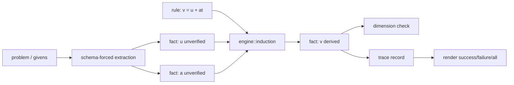

# OpenVerifiers — Architecture

**Verify AI agent claims through explicit, traceable, deterministic reasoning.**

This document is the design spec for the OpenVerifiers core toolkit. It defines the
ontology, the reasoning engine, the trace policy, and the packaging — in enough
detail that someone who was not in the original design conversation can build to it,
and someone extending the system (e.g. adding a new domain grammar) knows exactly
where their code belongs and what they must not touch.

Version 1 scope. See [Known Open Questions](#known-open-questions) for what is
deliberately unresolved.

---

## 1. Core Ontology

Three node/edge kinds make up every domain model. Everything a verifier ever
manipulates is one of these.

### 1.1 Fact node

A fact is an atomic piece of information — a value, a quantity, a stated condition.
It is the unit of truth the system reasons over.

| Field | Meaning |
|---|---|
| `id` | Stable identity. Two facts with the same id are the *same* fact. This is the deduplication key. |
| `value` | The fact's content. May be a literal (number, symbol), a symbolic expression, or absent (for a pure target/unknown placeholder). |
| `attributes` | Structured metadata. In physics: `dimension`, `unit`, `type` (e.g. physical quantity kind). Attributes gate whether a rule may consume the fact. |
| `status` | `truth` · `unverified_truth` · `derived` · `target` · `unknown` |
| `source` | Provenance — the problem statement, a `truth` axiom, or the rule that produced it. |
| `derivation` | Reference to the transformation that created this node (none for root facts). |

**Status meanings**

- `truth` — accepted axiom / root fact / a fact already proven in a prior step. Needs no derivation.
- `unverified_truth` — given in the problem or extracted from input; believed but not yet checked. This is the normal entry status for problem givens.
- `derived` — produced by applying a transformation to other facts. Carries a derivation reference.
- `target` — what we are asked to find. Unresolved until a rule derives it.
- `unknown` — explicitly impossible to determine with current knowledge/evidence. **First-class, not an error.** See §1.3.

### 1.2 Transformation / rule node

A transformation is a known rule or relationship that maps **a set of input facts to
an output fact**. It is the edge-labelling of the graph.

| Field | Meaning |
|---|---|
| `name` | Human name, e.g. `kinematics-v1-segment` |
| `precondition` | Predicate over input-fact attributes. Checks dimensions, types, and required input arity. A rule **only fires** if the precondition passes. |
| `relation` | The actual math/logic. A symbolic expression (sympy), a constraint set (z3), or a user-defined predicate. |
| `solver_hook` | Which backend resolves the relation given concrete inputs — `sympy.algebra`, `z3.sat`, or a custom hook. |
| `output` | The fact type/dimension the rule produces. |

Rules are shared engine-wide but defined per domain (in the domain grammar). The
engine is rule-agnostic: it calls `precondition`, then `relation` via the `solver_hook`.

**A rule is reversible by direction of search, not by a separate definition** — see §2.

### 1.3 Unknown node

Not a failure state. A fact can be marked `unknown` when none of the available rules
can derive it under the current knowledge base.

It carries:

| Field | Meaning |
|---|---|
| `reason` | Why it is unknown (e.g. "beyond current knowledge", "missing input fact", "no applicable rule"). |
| `evidence_needed` | What evidence/rule/fact would resolve it. |

An `unknown` verdict is a legitimate, auditable outcome — e.g. physics beyond the
model covered, or a plan step with no supporting givens. The pipeline still emits an
explainable trace, but flags the target as RESOLVED-UNKNOWN rather than a hard fail,
so downstream consumers can distinguish "proven wrong" from "cannot yet be proven."

---

## 2. Reasoning modes: induction and deduction

The same fact/transformation structure supports both directions **without
duplication** because the graph is edge-reversible at the *search* level: the
transformation is one definition; the engine decides whether to *apply* it forward
(inputs → output) or *backward* (search for facts that could produce an output).

### 2.1 Induction (forward)

- Start set = current facts (givens `unverified_truth`, plus any `truth` axioms).
- Repeatedly fire applicable transformations to derive new facts.
- Stop when the `target` fact appears as a derived fact, or a fixed-point of derivable
  facts is reached (no rule produces anything new).

Used when the data is plentiful and the goal is to see what can be derived.

### 2.2 Deduction (backward)

- Start from the `target` fact.
- Repeatedly ask: "which transformations could produce a fact like this?" — unapply.
- Each such rule exposes the *inputs* it needs; those inputs become sub-goals, to be
  satisfied forward from givens, or decomposed backward further.
- Stop when every leaf sub-goal is satisfiable from givens.

Used when the target is clearly determined and we want the minimal dependency chain,
typical for word problems (find `v` given `u,a,t`).

### 2.3 Why one structure, two directions

The transformation is the sole definition of the relationship. Forward search uses it
as `output = f(inputs)`; backward search queries it as `inputs ⊇ needed(output)`.
The precondition and dimension checks are identical in both directions. This means a
domain author writes each law once and gets both modes — no parallel forward/backward
implementations to keep in sync. Backward search is implemented as a goal-refinement
on the same fact store, never as a separate model.

---

## 3. Graph structure

The derivation history is a **Directed Acyclic Graph (DAG)**, deliberately not a
tree and not a cyclic graph.

### 3.1 Enforced by construction

- **Deduplication on fact identity**: any two attempts that produce the *same* fact
  (same `id`) collapse into one node. A fact is that fact, wherever it was reached.
- **No edge to an ancestor**: a transformation may not derive a fact that is an
  ancestor of any of its inputs. Applying facts `{A, B}` to derive `C` when `C` is
  already on the path that produced `A` is rejected.

### 3.2 Why loops are disallowed (explicit decision, not oversight)

The whole point of OpenVerifiers is **explainability**: a chain a human can audit.
A cyclic graph means a rule can "prove" a fact using a fact it itself depends on —
information that was never actually established is reused as evidence, which is
circular reasoning. An audit must be able to walk a derivation back to `truth`
axioms with strictly decreasing dependency; a cycle breaks that invariant and
turns the trace into "confusion," not reasoning. Loops also guarantee the forward
search terminates. This is a correctness and explainability guarantee, not a
performance shortcut.

The DAG also lets one fact serve as a premise for many rules and many subproblems,
which a tree (with copied nodes) would duplicate and make the shared-dependency
structure invisible.

---

## 4. Trace policy

### 4.1 Storage — full verbose

Every search stores *everything* in the same underlying graph:

- every path explored (each transformation firing),
- every node created (including derived facts later unused),
- every dead end and the reason,
- every rejected transformation (precondition failure, dimension mismatch, etc.)
  and the *why*.

There is one store. Nothing is thrown away at search time.

### 4.2 Render — derived views, not separate stores

The verbose store is filtered at render time into three views:

| View | Includes | Use when |
|---|---|---|
| `success-path` | only the nodes/edges on a path that reaches the target (or the explicit `unknown` for it) | human review of the answer |
| `failure-trail` | the success path **plus** the rejected/dead branches and their reasons | debugging why something failed / auditing every option considered |
| `full` | everything in the store | deep audit, tests, provenance |

These are projections over the one store, produced by the same graph. There is no
second trace structure. Because edges carry both success and rejection labels, all
three views are deterministic functions of the single recorded history.

---

## 5. Grammar sourcing

A **grammar** for a domain defines:

1. fact type schema — the allowed `attributes` (dimensions, units, quantity types) and statuses,
2. the rule library — the transformations, with preconditions, relations, solver hooks and outputs.

Two ways to obtain a grammar:

### 5.1 Manual specification (preferred, v1 default)

A human author writes the fact types and rules directly. High trust, precise
preconditions, auditable. The physics slice ships a manual grammar. Recommended for
domains where correctness is safety-critical and consequences of a wrong rule are high.

### 5.2 Agent-based auto-extraction (future, gated)

An agent reviews corpora (textbooks, solved problem sets) and proposes a grammar.
This is **not trusted automatically**.

**Benchmark gate — a testable definition of "passing":**

A candidate auto-extracted grammar "passes the benchmark" if and only if, on a curated
suite of *critical logical-checking* test cases (known inputs with known correct
outputs, plus known-invalid uses that must be *rejected* — e.g. units-match checks,
forbidden commitments, contradictions):

1. it reaches a correct result (within tolerance) for every case marked "must solve",
2. it positively **rejects** every case marked "must reject" (returns `unknown` /
   no-solution, **not** a wrong number),
3. it produces a trace in which every derived fact is traceable to a `truth`/`truth`
   root through valid transformations,
4. it demonstrates the checks (dimension/type mismatch, missing precondition)
   were actually enforced — the histogram of rule applications shows the failing
   ones rejected, not silently dropped.

A grammar that fails any of the *must* conditions is not accepted and is discarded
or sent back for revision. Manual authorship is always available as the determinism
and fallback regardless of agent output. This gate is itself a testable artifact in
the repo.

> Note: this gate is a trust boundary. It exists because a wrong rule is worse than
> no rule — a silent mis-derivation defeats the entire purpose of a verifier, and an
> auto-extracted grammar is exactly the source that is *most* likely to smuggle in a
> plausible-but-wrong rule.

---

## 6. Root logic

### 6.1 Domain roots

A grammar may declare its own **root facts/axioms** — facts with no parent
transformation, which the domain treats as foundational (e.g. `F = ma` is a
definitional relation in mechanics; units/base relations). Domain roots are
expected and allowed. They are `truth` nodes with no source field beyond their
declared statement and are trusted as inherent to the domain, not derived.

A domain root is *not* global truth for other domains — it is scoped to the
grammar that declares it. Cross-domain reduction (seeing a legal rule as "really"
a conservation principle, say) is, at most, consensual future work, not v1.

### 6.2 Minimal universal root-logic research

> **Explicitly out of scope for v1.** Do not let this leak into the build.

There is an open research question: **is there a small fundamental set of
root facts/logic out of which every domain can be derived?** Proving that, or even
hazard it exists, touches mathematics-adjacent invertibility, physics axiomatization,
and possibly lying — open questions in formal-ML. v1 does **not** attempt to solve it
and does **not** require domain roots to be proven from universal roots. Domain roots
stand alone within their status. This is recorded as a research thread (see
[Known Open Questions](#known-open-questions)) and is explicitly not a v1
dependency.

---

## 7. Packaging

Three layers, strict boundary. Domain adapters must not leak the core's internals
through CLI or MCP.

```
┌─────────────────────────────────────────────┐
│  CLI  (openverifiers/cli.py)                │
│  thin: parse args → call SDK → print        │
└───────────────────┬─────────────────────────┘
                    │ publishes to / consumes JSON
┌─────────────────────────────────────────────┐
│  SDK core (openverifiers/)                  │
│  fact/transformation models, engine,        │
│  DAG, trace render, sympy/z3 hooks          │
└───────────────────┬─────────────────────────┘
                    │
          ┌─────────┴──────────┐
          │ grammars/physics   │  domain code lives HERE only
          └────────────────────┘
```



### 7.1 SDK

The core library. Fact/transformation model, DAG engine, trace store, render
projections, solver hooks. Exposes `Engine`, `Fact`, `Transformation`,
`solve()`, `trace()`. This is the only layer that manipulates the internal
structure.

### 7.2 CLI

Thin wrapper over the SDK: read a problem, extract facts, run the engine, print
a trace. It must not reach into DAG internals or the grammar rule store directly; it
calls only the public SDK surface. Keeps domain logic in the grammar, not in argv.

### 7.3 MCP server

Exposes `verify()` as an agent-callable tool. It serializes the SDK result
(verdict, trace, unknown flags) to JSON-RPC. No domain logic, no graph internals.
Boundary guarantee: an agent can call `verify` but never touch the fact store or
rule text.

> Future domain adapters implement in `grammars/` (SDK layer only). They add rule
> libraries and fact schemas; they do not add CLI flags or MCP verbs for private
> internals. This keeps the core engine domain-agnostic (a stated goal in README) and
> keeps CLI/MCP stable across domains.

---

## 8. Physics vertical slice — what "done" means

A bounded, working, CLI-verifiable slice:

1. **Grammar** (`grammars/physics.py`): fact types for kinematic/mechanical
   quantities (velocity, time, distance/displacement, acceleration, mass, force, and
   the needed derived ones) with dimension/unit attributes; a rule library covering a
   small real subset: `v = u + a·t`, `s = u·t + ½·a·t²`, `v² = u² + 2·a·s`,
   `t = (v−u)/a`, `F = m·a`, `s = (u+v)/2 · t`, `K = ½·m·v²`, `W = F·s`.
   Dimension checking enforced on every rule — rejected steps record the rejected
   reason ("dimension mismatch"). The algebra solver applies the physics magnitude
   convention for velocity-like targets: a multi-valued root set resolves to the
   positive real root (textbook problems expect the magnitude). Multi-step
   composition (e.g. `v = u + a·t`, then `K = ½·m·v²`) is supported.
2. Two search modes: induction (forward) and deduction (backward), both
   engine-provided, physics uses deduction for word problems (target-forward
   decomposition), documented below.
3. Input: a natural-language problem string → `unverified_truth` facts + `target`.
4. Solver hook: sympy algebra resolves relations symbolically.
5. Output: full verbose trace + `success-path` + `failure-trail` render via the
   same render function.
6. Benchmark: ≥15 JEE/CBSE/HSC kinematics-mechanics problems, known answers, run
   through the pipeline; pass/fail recorded in `RESULTS.md` (actual count, not an
   estimate).
7. `unknown` handled (e.g. missing given → target `unknown` with an
   evidence_needed note).

Non-goals for this slice (explicit):

- No legal/finance/lawyer domains.
- No auto-extraction grammar path (manual only).
- No minimal-root-logic solution.
- No UI — CLI only.

---

## 9. Known Open Questions

Deliberately unresolved; do not 'resolve' them prematurely in the code.

1. **Trace storage scaling.** Storing every path/rejection (full verbosity) is
   unbounded on large search spaces. When/how to rotate, summarize, or time-box
   verbose ingestion while preserving audit integrity is open. Current: assume
   problem-scale usage where full store is fine.
2. **Benchmark gate rigor.** The §5.2 gate is concrete but the *curation* of the
   must-solve/must-reject suite (size, diversity, adversarial coverage) is not
   formalized. What makes a suite "good enough" to admit an auto-extracted grammar
   is open.
3. **Minimal-root-logic research thread.** Whether all domains reduce to a small
   universal root set. Explicitly research-only; not a v1 requirement.
4. **Rule arity / mult-step composition.** How rich a single transformation can be
   before it becomes a sub-graph (a macro). Whether composition should be
   first-class or stay ad-hoc.
5. **Unknown-vs-wrong disambiguation.** A fact that is `unknown` may be genuinely
   unknowable or merely outside coverage. Metrics to distinguish "out of scope"
   from "actual gap" are open.
6. **Numerical vs symbolic ground.** This slice is symbolic (sympy). Whether/when
   to ground derived facts with numerical solvers if the target requires a value is
   an open choice, not a committed decision.

---

## 10. Related: the dual pipeline (symbolic + statistical/LLM-judge)

The README pitches a dual pipeline: symbolic (this architecture) and statistical
(LLM-judge) for claims not cleanly formalizable. The **statistical pipeline is NOT
implemented in the v1 vertical slice** — the slice proves the deterministic core
first. The statistical layer is a recognized extension, and its interface (a
confidence-scored verdict distinct from the symbolic verdict) is retained as a shape
in the CLI output, but the judge itself is a stub until the symbolic core is
validated. This is a deliberate sequencing decision, not an abandonment of the README
design.

---

*End of architecture. Build decisions for the physics slice flow from this.*