# OpenVerifiers architecture (Milestone 1)

How the system works from start to finish, in 13 diagrams. Everything here
matches the code on `m1-kernel`. The numbers come from
[`benchmarks/results/latest.md`](../benchmarks/results/latest.md).
Diagrams are Mermaid, so GitHub and most editors render them.

1. [System and trust boundary](#1-system-and-trust-boundary)
2. [`check()` in four stages](#2-check-in-four-stages)
3. [Per-step gates](#3-per-step-gates)
4. [Data model](#4-data-model)
5. [Fact status lifecycle](#5-fact-status-lifecycle)
6. [Trust tiers and grade decision](#6-trust-tiers-and-grade-decision)
7. [Math pack](#7-math-pack)
8. [code_requirements pack](#8-code_requirements-pack)
9. [Repair loop](#9-repair-loop)
10. [Proposers and the repair demo](#10-proposers-and-the-repair-demo)
11. [Mutation benchmark pipeline](#11-mutation-benchmark-pipeline)
12. [Measured catch rates](#12-measured-catch-rates)
13. [Guarantees, assumptions and gaps](#13-guarantees-assumptions-and-gaps)

---

## 1. System and trust boundary

Proposers are untrusted and only emit proofs. The kernel is trusted. It is
stdlib-only, pure and deterministic, and it calls domain logic only through the
hooks a `DomainPack` registers. Packs are trusted the way a proof assistant's
standard library is: they are reviewed code, never proposer input.

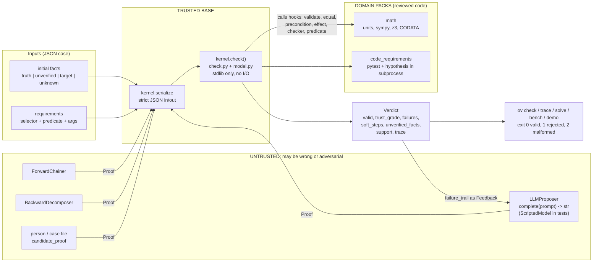

Hard rule: a pack never needs a kernel change. `git diff 5caedc4 -- openverifiers/kernel`
is empty across both packs.

---

## 2. `check()` in four stages

`check(initial_facts, requirements, proof, pack) -> Verdict`. It does not stop
at the first error. Every step ends up accepted, rejected or skipped, so the
trace is usable as repair feedback.

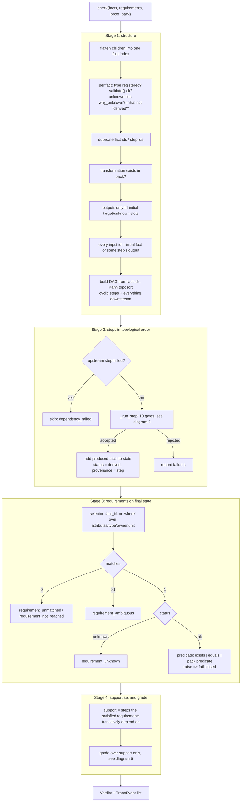

Failure codes (25, in `model.FAILURE_CODES`):

| stage | codes |
|---|---|
| structure | `duplicate_step_id`, `duplicate_fact_id`, `unknown_fact_type`, `invalid_fact`, `unknown_transformation`, `missing_input`, `cycle` |
| steps | `dependency_failed`, `input_role_mismatch`, `output_role_mismatch`, `input_type_mismatch`, `input_not_established`, `input_unknown`, `precondition_failed`, `effect_error`, `output_mismatch`, `checker_rejected`, `checker_error`, `citation_missing` |
| requirements | `requirement_unmatched`, `requirement_ambiguous`, `requirement_unknown`, `requirement_not_reached`, `requirement_failed`, `unknown_predicate` |

---

## 3. Per-step gates

`_run_step` stops at the first failing gate for that step. Every hook
exception is caught and turned into a failure ("fail closed"), and is never
propagated.

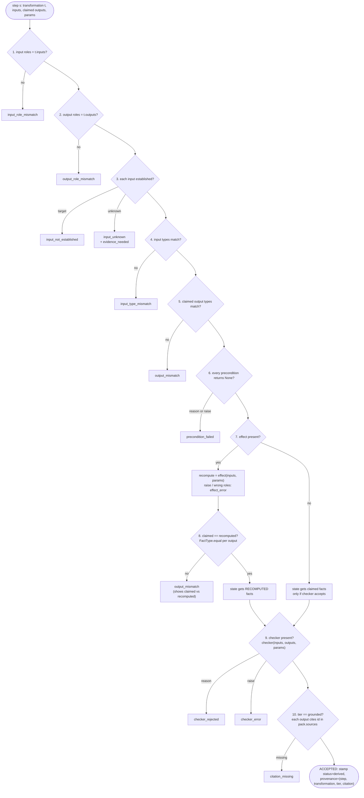

Equality is pack-defined. The default is: same type, unit and owner, and values
`isclose(rel=1e-9, abs=1e-12)` for numbers, `==` otherwise. The math pack
overrides it to compare quantities after SI conversion.

---

## 4. Data model

All kernel types are frozen dataclasses in `openverifiers/kernel/model.py`.

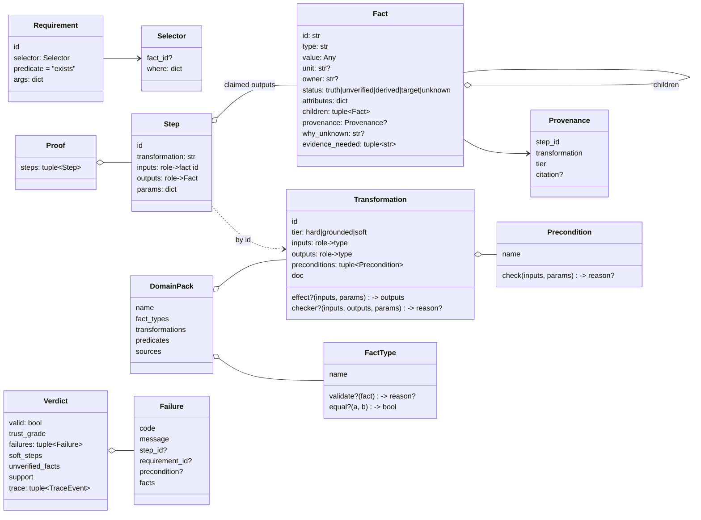

`DomainPack` refuses to construct if a predicate shadows a built-in (`exists`,
`equals`) or a transformation names an unregistered fact type.

---

## 5. Fact status lifecycle

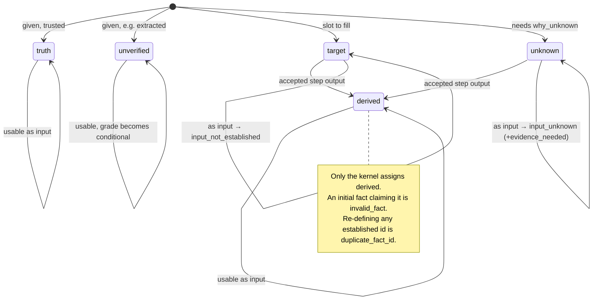

---

## 6. Trust tiers and grade decision

| tier | what the kernel checks | what the pack checks |
|---|---|---|
| `hard` | recompute equals claim, or checker accepts | the math/test logic |
| `grounded` | the citation id exists in `pack.sources` | that the source content supports the claim |
| `soft` | only that it is a declared soft transformation | judgment; accepted conditionally |

The grade is computed only over the **support set**. A soft step that no
satisfied requirement depends on does not lower the grade. Any failure anywhere
still makes the proof invalid.

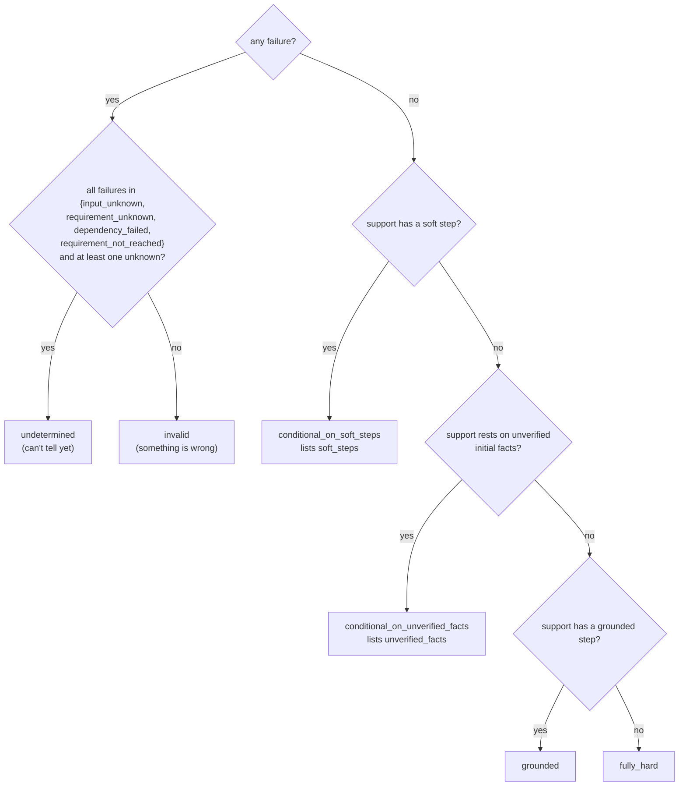

---

## 7. Math pack

`openverifiers/domains/math/` provides 30 transformations. Units are strings
parsed into 7-exponent SI dimension vectors.

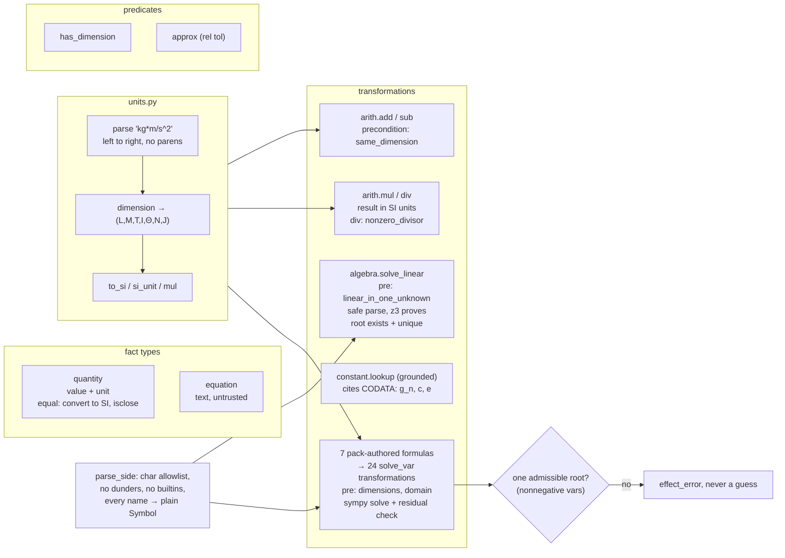

Proposers cannot submit their own "hard" formula. Formulas exist only as pack
code.

---

## 8. code_requirements pack

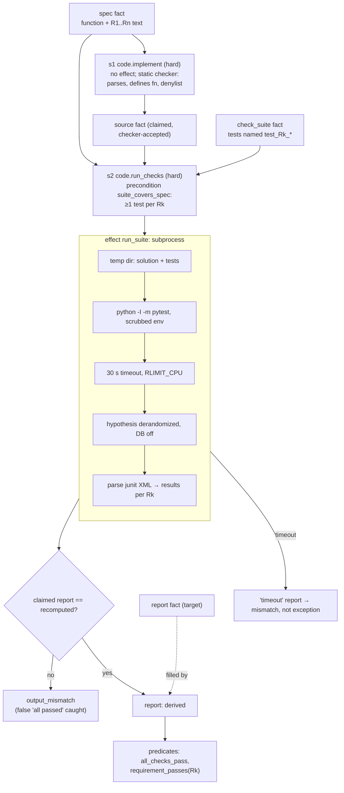

Limit: the pack trusts the compiled checks. If the tests under-specify a
requirement, wrong code passes.

---

## 9. Repair loop

`proposers/repair.py`. The kernel is the only judge in the loop.

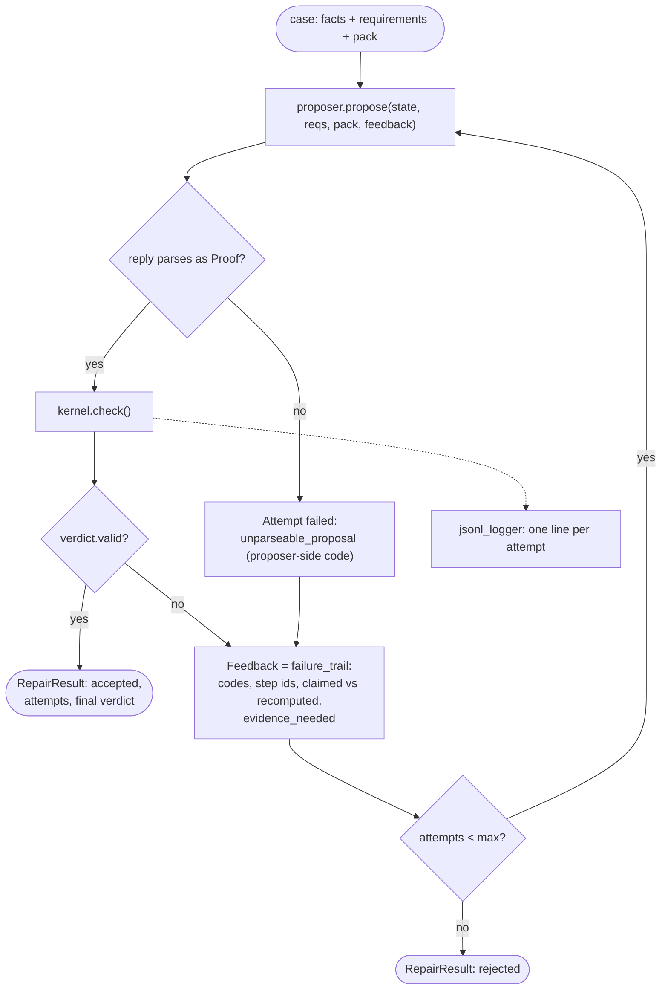

---

## 10. Proposers and the repair demo

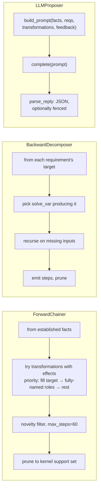

Search proposers bind roles by `attributes.symbol` or id. They solve 4 of 7
math cases (forward) and 3 of 7 (backward).

`ov demo repair` (braking-force case, scripted model):

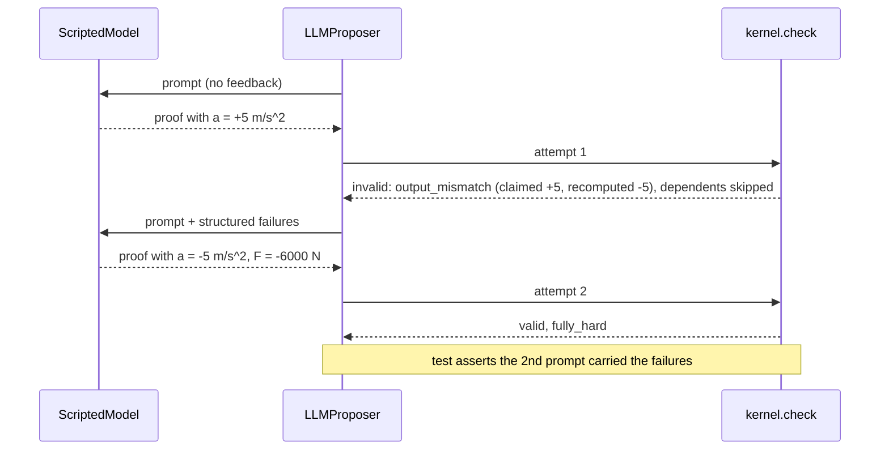

---

## 11. Mutation benchmark pipeline

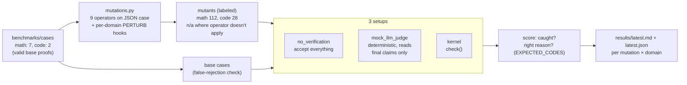

Operators: `unit_mismatch`, `sign_error`, `dropped_step`,
`missing_precondition` (remove a consumed premise), `wrong_effect`,
`unreachable_target`, `duplicated_fact_id`, `circular_dependency`, plus
`misread_given` (consistent misreading of a given number).

---

## 12. Measured catch rates

Math domain, catch rate % per mutation (mock judge vs kernel). Order on the
x-axis: unit, sign, dropped, missing_pre, wrong_effect, unreachable, dup_id,
cycle, misread.

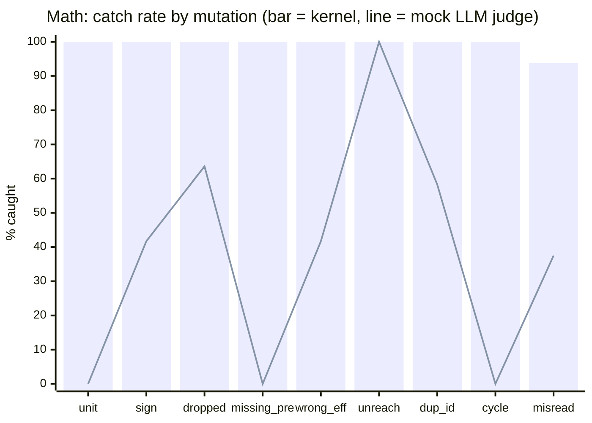

| domain | mutants | no verification | mock LLM judge | kernel | right reason | false rejections |
|---|---|---|---|---|---|---|
| math | 112 | 0.0% | 34.8% | 99.1% | 99.1% | 0 / 7 |
| code_requirements | 28 | 0.0% | 50.0% | 100.0% | 100.0% | 0 / 2 |

The one miss is `math_drop_speed~misread_given~0`. The mass is misread as
2 → 4 kg and everything after it is recomputed consistently. Impact speed
doesn't depend on mass, so the requirement still holds. The kernel checks
proofs against their requirements, not against intent.

These operators each break a rule the kernel was built to check, so this is a
regression suite, not evidence about real proposer error distributions.

---

## 13. Guarantees, assumptions and gaps

```mermaid
flowchart LR
  subgraph G["GUARANTEED by the kernel"]
    g1["no step result taken on trust:<br/>recomputed or checker-accepted"]
    g2["DAG well-formed: no cycles,<br/>no missing inputs, no redefinition"]
    g3["hook exceptions fail closed"]
    g4["unknown never silently passes"]
    g5["grade reflects weakest tier<br/>in the support set"]
    g6["deterministic, pure, stdlib-only<br/>(import test enforces it)"]
  end
  subgraph A["ASSUMED (outside the kernel)"]
    a1["pack hooks are correct"]
    a2["requirements capture intent"]
    a3["truth facts are true"]
    a4["code checks cover the spec"]
    a5["sympy is right<br/>(residual check not independent)"]
  end
  subgraph X["KNOWN GAPS"]
    x1["misread givens the requirements<br/>don't pin down"]
    x2["sandbox is isolation, not security"]
    x3["no real LLM run yet;<br/>judge column is a mock"]
    x4["small samples: 7 math, 2 code"]
    x5["search proposers: formula-shaped only"]
    x6["CI not yet run; 3.11 untested locally"]
  end
  subgraph D["EXTERNAL DEPENDENCIES"]
    d1["sympy: formula solving"]
    d2["z3-solver: linear uniqueness"]
    d3["pytest + hypothesis: code checks"]
    d4["CODATA values: grounded sources"]
  end
  D --> A
  A --> G
```
