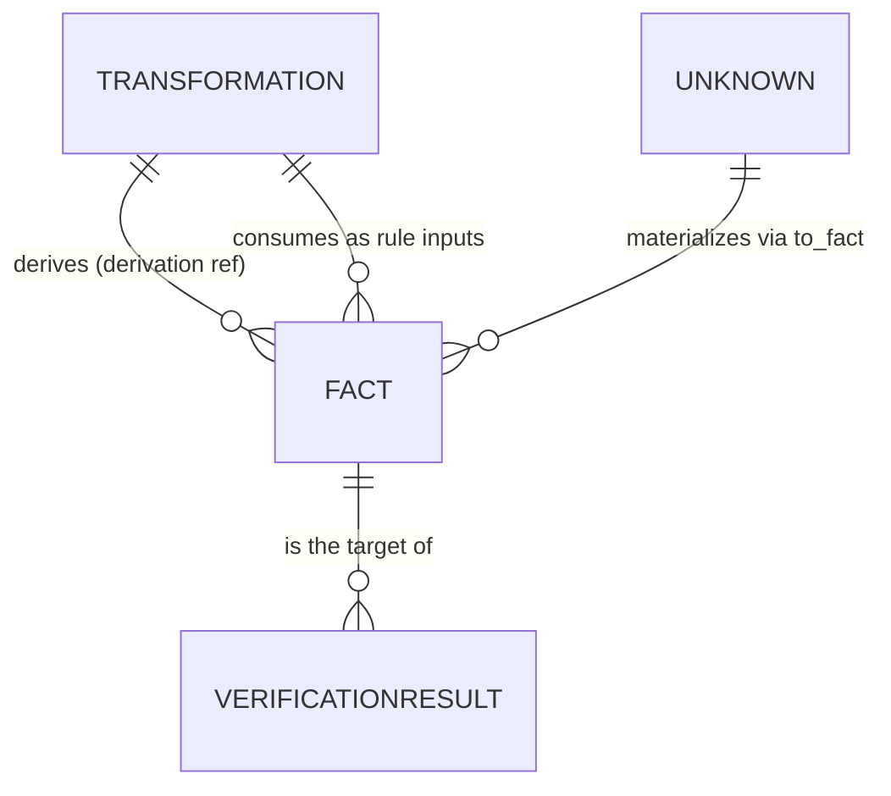
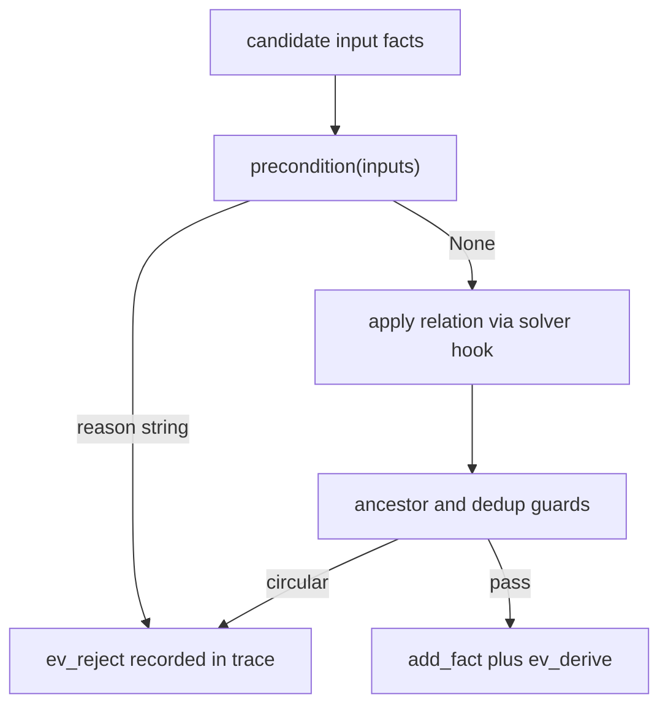

# Core Ontology — Facts, Transformations, Unknowns

The OpenVerifiers core is built on **three node kinds**: a `Fact` (atomic unit of truth), a `Transformation` (the rule/edge that maps input facts to an output fact), and an `Unknown` (a first-class "cannot determine" outcome). Everything a verifier ever manipulates is one of these — a domain model is, by definition, a set of fact types plus a rule library over them [v1] (repo://ARCHITECTURE.md#L16-L19). The canonical design record fixes this trio as finalized v1 (repo://docs/design.md#L43-L54), and the shipped implementation lives in `model.py` (repo://model.py#L1-L150), consumed by the engine (repo://engine.py#L1-L19).

Caption: the three ontology node kinds plus the run result record, as they relate in model.py.

## Fact — the unit of truth, frozen and identity-keyed

A fact is an atomic piece of information — a value, a quantity, a stated condition — and the unit the system reasons over [v1] (repo://ARCHITECTURE.md#L21-L24). It is a frozen dataclass (repo://model.py#L30-L37): **derivation creates new facts; nothing mutates an existing one** [v1]. This immutability is what lets the same fact safely serve as a premise for many rules and many subproblems in the DAG [v1] (repo://ARCHITECTURE.md#L142-L144).

| Field | Meaning |
|---|---|
| `id` | Stable identity. Two facts with the same id are the *same* fact; this is the DAG deduplication key [v1] (repo://model.py#L34-L36, repo://ARCHITECTURE.md#L28). |
| `value` | The fact's content: a literal (number, symbol), a symbolic expression, or absent for a pure target/unknown placeholder [v1] (repo://ARCHITECTURE.md#L29; repo://grammars/input.py#L125-L135). |
| `attributes` | Structured metadata. In physics: `fact_kind`, `symbol`, `dimension`, `unit`. Attributes gate whether a rule may consume the fact [v1] (repo://ARCHITECTURE.md#L30; repo://grammars/physics.py#L74-L88). |
| `status` | One of exactly five shipped statuses (below) [v1] (repo://model.py#L12-L24). |
| `source` | Provenance — the problem statement, a `truth` axiom, or the rule that produced it [v1] (repo://ARCHITECTURE.md#L32; repo://model.py#L43). |
| `derivation` | Reference to the transformation that created this node; `None` for root facts [v1] (repo://ARCHITECTURE.md#L33; repo://model.py#L44). |

### The id-identity contract and DAG deduplication

The identity contract is strict and enforced by the engine: `Engine.add_fact` keeps a `dict[str, Fact]` keyed by `id`, and a collision returns the *existing* fact rather than inserting a second copy (repo://engine.py#L74-L81). Consequences, all [v1]:

- any two attempts that produce the same fact collapse into one node (repo://ARCHITECTURE.md#L125-L128);
- in induction, when a rule fires but `add_fact` finds the output already known, the engine records an `ev_join` event instead of a duplicate derive (repo://engine.py#L213-L220);
- because a fact *is* that fact wherever it was reached, an audit can walk a derivation back to `truth` axioms with strictly decreasing dependency — the DAG is enforced by construction, not by post-hoc checking (repo://ARCHITECTURE.md#L120-L130).

The physics slice gives each fact kind a singleton default id (`u`, `v`, `t`, `a`, `s`, `m`, `F`, `K`, `W`), so within that grammar a fact is identified by its quantity symbol (repo://grammars/physics.py#L56-L60).

### The five statuses — no more, no less [v1]

The status vocabulary is exactly `truth`, `unverified_truth`, `derived`, `target`, `unknown`, declared as constants with `ALL_STATUSES` (repo://model.py#L12-L24). `Fact.__post_init__` raises `ValueError` for any other status, so an invalid status is a programming error caught at construction time, not a silent corruption (repo://model.py#L46-L48).

| Status | Meaning |
|---|---|
| `truth` | Accepted axiom / root fact / already proven. Needs no derivation [v1] (repo://ARCHITECTURE.md#L37). |
| `unverified_truth` | Given in the problem or extracted from input; believed but not yet checked. The normal entry status for problem givens [v1] (repo://ARCHITECTURE.md#L38; repo://grammars/input.py#L120-L121). |
| `derived` | Produced by applying a transformation to other facts; carries a derivation reference [v1] (repo://ARCHITECTURE.md#L39; repo://grammars/physics.py#L121-L122). |
| `target` | What we are asked to find. Unresolved until a rule derives it [v1] (repo://ARCHITECTURE.md#L40). |
| `unknown` | Explicitly impossible to determine with current knowledge/evidence. **First-class, not an error** [v1] (repo://ARCHITECTURE.md#L41; repo://model.py#L101-L107). |

An `estimated`/uncertainty status with confidence or interval is a **finalized v1 design direction** from the research additions (repo://docs/newer-additions.md#L77-L88, research synthesis §8) — but it is **not shipped**: `model.py` validates only the five statuses above, so any sixth status is future work, never current behavior.

## Transformation — the rule node, precondition-gated and reversible

A transformation is a known rule or relationship mapping **a set of input facts to an output fact**; it is the edge-labelling of the graph [v1] (repo://ARCHITECTURE.md#L43-L46). It carries `name`, `output_kind`, `input_kinds`, `precondition`, `relation`, `solver_hook`, and `doc` (repo://model.py#L54-L75). Rules are shared engine-wide but defined per domain in the domain grammar; the engine itself is rule-agnostic — it calls `precondition`, then `relation` via the `solver_hook` [v1] (repo://ARCHITECTURE.md#L56-L57).

### The precondition contract — auditable rejection

The precondition is the gate a rule must pass before it may fire. The contract is precise:

- `precondition(inputs) -> str | None`: return `None` to allow firing, or a **non-empty reason string** explaining why not — dimension mismatch, missing fact kind, wrong arity, and so on (repo://model.py#L57-L60, repo://model.py#L81-L83).
- The default precondition (used when none is supplied) always returns `None` — a rule with no precondition never rejects (repo://model.py#L77-L79).
- **Every rejection is recorded**: the engine appends an `ev_reject` trace event with the rule name, the input fact ids, and the reason string (repo://engine.py#L40-L41), both in deduction (repo://engine.py#L150-L153) and in induction (repo://engine.py#L203-L205). A rejected application is therefore an auditable, rendered part of the trace — never a silent drop.

Caption: the rule-firing path — precondition gate, solver-backed relation, then the engine's DAG guards.

### Relation and solver hook

`relation(inputs) -> (output_fact, trace_note)` computes the output fact from the inputs, usually by delegating to a solver backend (repo://model.py#L62-L64, repo://model.py#L85-L92). The `solver_hook` is a backend token such as `sympy.algebra`; the engine and grammar dispatch through the solver registry, keeping the core free of any direct sympy dependency (repo://solvers.py#L93-L101). `apply()` runs the relation and raises `RuntimeError` if a rule has no relation at all — a misconfigured rule fails loudly at firing time (repo://model.py#L85-L92).

### Reversible by search direction, not by a parallel definition [v1]

A transformation is the **sole definition** of its relationship. There is no forward-rule and backward-rule pair to keep in sync:

- induction applies it forward: `output = f(inputs)` (repo://ARCHITECTURE.md#L88-L94, repo://engine.py#L188-L231);
- deduction queries it backward: `inputs ⊇ needed(output)`, asking which transformations could produce a fact like the target and turning each rule's input kinds into sub-goals (repo://ARCHITECTURE.md#L97-L105, repo://engine.py#L132-L170);
- the precondition and dimension checks are identical in both directions; backward search is goal-refinement on the same fact store, never a separate model (repo://ARCHITECTURE.md#L107-L114).

This is the design decision that lets a domain author write each law once and get both reasoning modes, with no parallel implementations to drift (repo://docs/design.md#L56-L62).

## Unknown — the legitimate auditable outcome, never a failure

An `Unknown` is a first-class "cannot determine" node carrying exactly two fields: `reason` (why it is unknown — missing input fact, no applicable rule, beyond current knowledge) and `evidence_needed` (what evidence, rule, or fact would resolve it) (repo://model.py#L101-L107, repo://ARCHITECTURE.md#L62-L72). `Unknown.to_fact()` maps it into the fact space as a `Fact` with `value=None`, `status=unknown`, `source="unknown"`, `derivation=None` (repo://model.py#L113-L121).

An `unknown` verdict is a **legitimate, auditable outcome**, not an error or a crash: the engine records an `ev_unknown` trace event with the reason and evidence (repo://engine.py#L52-L53) and returns an `UNKNOWN` result when no rule could derive the target (repo://engine.py#L98-L104, repo://engine.py#L227-L231). The pipeline still emits an explainable trace but flags the target as resolved-unknown rather than a hard fail, so downstream consumers can distinguish **"proven wrong"** from **"cannot yet be proven"** [v1] (repo://ARCHITECTURE.md#L73-L76).

The verified core is open-world: absence of a fact is *unknown*, never *false*. The design record fixes the recommended verdict vocabulary as **verified / contradicted / unverified-unknown** and forbids emitting "false" merely because a fact is absent (repo://docs/research/synthesis.md#L22-L30; repo://docs/research/03-dl-abox-tbox.md#L111).

The engine verdict surface is `VerificationResult.status`, typed as `'RESOLVED' | 'UNRESOLVED' | 'UNKNOWN'`; the shipped paths emit `RESOLVED` (target derived) or `UNKNOWN` (no derivation possible), with `UNRESOLVED` reserved by the type but not produced by v1 code (repo://model.py#L127-L136, repo://engine.py#L98-L104). The result carries `target`, `status`, `answer`, and the three trace views `success_path`, `failure_trail`, and `full` (repo://model.py#L127-L136).

## How the three kinds fit together — lifecycle and invariants

- **Entry.** Problem givens enter as `unverified_truth` facts; the target enters as a `target` fact with no value (repo://grammars/input.py#L120-L135). If no target can be identified, `verify_physics` short-circuits to an `UNKNOWN` result carrying an evidence note ("phrase your target as 'find the <quantity>'") (repo://__init__.py#L38-L52).
- **Derivation.** Rules fire through the precondition gate → solver-backed relation → engine guards, producing `derived` facts with a derivation reference (repo://engine.py#L150-L169).
- **Dead end.** No rule produces the target → `ev_unknown` + `UNKNOWN` verdict (repo://engine.py#L98-L104).
- **Invariants.** Facts never mutate (frozen); the same id is the same fact everywhere (dedup); a transformation may not derive a fact that is an ancestor of any of its inputs — circular "proof" is rejected with a recorded reason (repo://engine.py#L161-L165, repo://ARCHITECTURE.md#L125-L140).

## Domain roots, scoping, and the extension boundary

A grammar may declare **domain roots** — facts with no parent transformation that the domain treats as foundational (e.g. `F = ma` as a definitional relation); they are `truth` nodes trusted as inherent to the domain, scoped to the grammar that declares them, and explicitly *not* global truth for other domains [v1] (repo://ARCHITECTURE.md#L228-L238). Whether all domains reduce to a small universal root set is a **research thread, explicitly out of scope for v1** [out-v1] (repo://ARCHITECTURE.md#L240-L251; repo://docs/design.md#L82-L87).

The ontology is the extension boundary: a new domain supplies a fact-type schema (allowed attributes and statuses) plus a rule library (transformations with preconditions, relations, solver hooks, and outputs), living in `grammars/` only — the core model and engine stay domain-agnostic [v1] (repo://ARCHITECTURE.md#L180-L184, repo://ARCHITECTURE.md#L307-L314). Domain adapters must not leak core internals through CLI or MCP (repo://ARCHITECTURE.md#L253-L258).

## Open questions touching the ontology

- **Rule arity / multi-step composition** [open]: how rich a single transformation can be before it becomes a sub-graph (a macro), and whether composition should be first-class or stay ad-hoc (repo://ARCHITECTURE.md#L368-L371).
- **Unknown-vs-wrong disambiguation** [open]: metrics to distinguish "out of scope" from an "actual gap" in the knowledge base (repo://ARCHITECTURE.md#L371-L375).
- **Identity policy** [open]: the DL literature assumes no unique-name policy, so two fact nodes with distinct ids may denote one individual — an explicit `sameAs`/`differentFrom` policy is needed before consistency checking is trustworthy (repo://docs/research/synthesis.md#L135-L137, repo://docs/research/synthesis.md#L194-L201).

## Related pages

- /openwiki/architecture/engine.md — how the engine consumes facts and transformations for deduction and induction
- /openwiki/architecture/trace.md — how fact creation, rejections, dead ends, joins, and unknowns are recorded
- /openwiki/architecture/layers.md — the CLI / SDK core / grammars packaging boundary built on this ontology
- /openwiki/architecture/solvers.md — the solver registry behind the transformation `solver_hook`
- /openwiki/concepts/unknown-open-world.md — the open-world semantics of the first-class Unknown node
