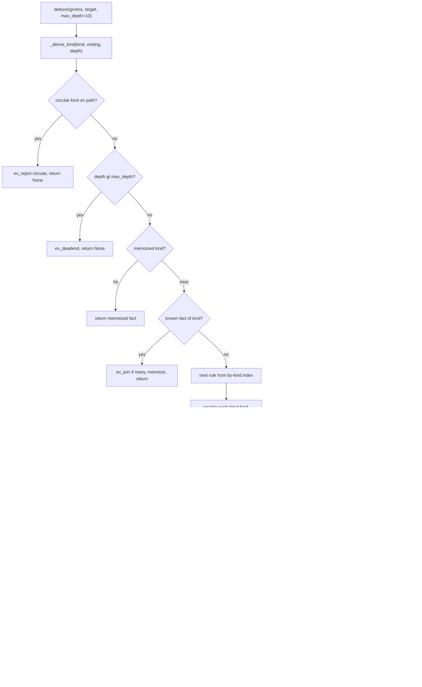

# Reasoning Engine — Deduction and Induction

`engine.py` is the search and graph-building core of OpenVerifiers. It implements ARCHITECTURE.md §2 (induction and deduction) and §3 (a DAG whose construction rules make loops impossible) over the fact/transformation ontology defined in `model.py` (see /openwiki/architecture/core-ontology.md). Deduction is **backward chaining with memoization**; induction is **forward fixed-point closure**. Both are driven by the same `Transformation` definitions — a rule is reversible by search direction, never by a parallel forward/backward pair [v1] (repo://ARCHITECTURE.md#L82-L85, repo://ARCHITECTURE.md#L107-L114).

## Engine state and the rule index

Every `Engine` instance owns the full in-memory model of a verification run (repo://engine.py#L59-L71):

| Store | Shape | Role |
|---|---|---|
| `rules` | `list[Transformation]` | The rule library, shared engine-wide but defined per domain grammar |
| `trace` | `list[dict]` | The single verbose event store — never trimmed at search time (ARCH §4) |
| `_facts` | `dict[str, Fact]` | Fact store keyed by `id` — the deduplication structure |
| `_parents` / `_children` | `dict[str, set[str]]` | The DAG edge sets: output id → input ids, and input id → output ids |
| `_memo` | `dict[str, Optional[Fact]]` | Per-kind memo: a cached `Fact` on success, `None` on cached failure |
| `_by_kind` | `dict[str, list[Transformation]]` | Rules indexed by output kind, built once in the constructor |

The `_by_kind` index is what makes backward search cheap: to resolve a goal kind, deduction looks up exactly the rules that can produce it instead of scanning the whole library (repo://engine.py#L68-L71). `_record_derive` maintains both edge sets and appends the `derive` trace event in one place, so the graph structure and the audit trail can never diverge (repo://engine.py#L83-L87).

Fact identity is the dedup key: `add_fact` returns the **existing** fact when an id collides rather than inserting a second node — "a fact is that fact, wherever it was reached" [v1] (repo://engine.py#L74-L81, repo://ARCHITECTURE.md#L125-L128). Because `Fact` is a frozen dataclass, derivation always creates new facts; nothing mutates an existing node, which is what lets one fact safely serve as a premise of many rules in the shared DAG (repo://model.py#L30-L37, repo://ARCHITECTURE.md#L142-L144).

## Deduction — backward goal refinement

`deduce(givens, target, max_depth=10)` is the entry point (repo://engine.py#L90-L104). It registers the givens, **resets the memo for the run**, and asks `_derive_kind` to resolve the target's `fact_kind` starting from an empty `visiting` set at depth 0. The target fact itself participates only as a goal: its status is `target` and its value is `None`, so the known-fact scan never mistakes it for an answer.

`_derive_kind(kind, target, visiting, depth, max_depth)` is the recursive resolver with five ordered gates (repo://engine.py#L106-L174):

1. **Circular kind guard** — if `kind` is already in `visiting` (the set of kinds on the current path), the resolution rejects with an `ev_reject` event `"circular: kind … already on path"` and returns `None` (repo://engine.py#L110-L112).
2. **Depth bound** — `depth > max_depth` records an `ev_deadend` `"max depth exceeded"` and fails; each recursive sub-goal increments depth by one, so `max_depth=10` bounds the longest goal chain, not the number of facts (repo://engine.py#L113-L115).
3. **Memo** — a prior success for this kind returns the cached fact; a prior failure (kind maps to `None`) returns `None` immediately (repo://engine.py#L116-L120).
4. **Known facts** — any fact of this kind already in the store with a value and status `truth` / `unverified_truth` / `derived` satisfies the goal; if several candidates exist, an `ev_join` event names them all and the first is memoized (repo://engine.py#L122-L130).
5. **Per-kind rule search** — for each rule in `_by_kind[kind]`, each input kind becomes a **sub-goal** resolved by the same recursion with `kind` added to the visiting set; a single unresolvable input records an `ev_deadend` (`"needed for rule …"`) and moves to the next rule (repo://engine.py#L132-L148).

Once every input kind resolves, the candidate faces the **precondition gate**: `rule.precond(inputs)` returns `None` to allow firing or a reason string that is recorded as `ev_reject` — dimension mismatch and arity errors surface here (repo://engine.py#L150-L153; see /openwiki/architecture/solvers.md for the dimension algebra). If it passes, `rule.apply(inputs)` runs the relation (the grammar's relation closure resolves the solver hook; the engine never touches sympy itself), with a `relation error:` `ev_reject` on exception (repo://engine.py#L155-L159). Finally the **ancestor guard** computes the union of the inputs' ancestor closures from `_parents` and rejects the derivation if the produced fact id is among them — `"circular: … in ancestors of inputs"` (repo://engine.py#L161-L165, repo://engine.py#L176-L185). Only then is the fact added, the derive edge recorded, the kind memoized, and the fact returned (repo://engine.py#L167-L170). Exhausting all rules without a result memoizes the failure (`self._memo[kind] = None`), records `ev_deadend "no rule or known fact"`, and returns `None` (repo://engine.py#L172-L174).

Caption: the `deduce()` goal-refinement path — known-fact short-circuit, per-kind rule search, recursive input resolution, precondition gate, ancestor guard, derive — exactly the gates `_derive_kind` implements (repo://engine.py#L106-L174).

When the goal resolves, `deduce` appends a synthetic `derive` event tagged `TARGET-REACHED` listing the givens in the target's parent set, then returns a `RESOLVED` result carrying the derived value (repo://engine.py#L98-L100). When no rule could derive the target, it records `ev_unknown` (`"no rule could derive the target from available givens"`, evidence hint `"add a missing given or rule"`) and returns `UNKNOWN` with no answer (repo://engine.py#L102-L104).

## Induction — forward closure

`induce(givens, target_id, max_rounds=8)` implements ARCH §2.1 verbatim: start from the given facts, fire every applicable transformation, stop when the target is derived or the derivable set reaches a fixed point (repo://engine.py#L188-L191, repo://ARCHITECTURE.md#L87-L94). The loop body iterates **all rules** — induction does not use the `_by_kind` index, it explores everything derivable — and for each rule enumerates input subsets with `_combos`, which groups the frontier facts by `fact_kind` and yields the cartesian product shaped like `rule.input_kinds` (one fact per kind, in order) (repo://engine.py#L197-L199, repo://engine.py#L233-L249).

Per candidate:

1. an `applied` set dedups `(rule.name, sorted input ids)` combinations across rounds, so the same firing is never retried (repo://engine.py#L199-L202);
2. `rule.precond` gates the firing, recording `ev_reject` with the reason (repo://engine.py#L203-L206);
3. the ancestor union of the subset is computed **before** applying, and the result is accepted only if the output fact is not an ancestor of any input (repo://engine.py#L207-L213) — induction's half of the "no edge to an ancestor" invariant; note that unlike deduction, a circular candidate here is skipped silently rather than recorded as a rejection;
4. `rule.apply` runs inside try/except; a relation exception records `ev_reject "relation error: …"` (repo://engine.py#L208-L212);
5. on success, `add_fact` dedups by id: a genuinely new fact gets a `derive` record and extends the next round's frontier; an already-known output records `ev_join` instead of a duplicate derive (repo://engine.py#L213-L223).

If the produced fact's id equals `target_id`, induction returns `RESOLVED` immediately (repo://engine.py#L221-L222). A round that produces nothing breaks the loop early (repo://engine.py#L224-L225); `max_rounds=8` caps the closure regardless (repo://engine.py#L194). After the loop, a target fact already in the store with a value also resolves; otherwise `ev_unknown "no rule produced the target"` and an `UNKNOWN` result close the run (repo://engine.py#L227-L231).

The shipped physics driver never calls `induce` — it routes every word problem through `deduce` [v1] (repo://__init__.py#L54-L58, repo://ARCHITECTURE.md#L332-L334) — so induction is the forward-mode API for other drivers and for the §2.1 "data is plentiful" case.

## DAG-by-construction invariants, and why loops are rejected

The derivation history is a DAG "enforced by construction, not by post-hoc checking" [v1] (repo://ARCHITECTURE.md#L120-L130):

- **Deduplication on fact identity.** `add_fact` collapses any two attempts that produce the same id into one node; induction additionally records the `join` when a rule re-derives a known fact (repo://engine.py#L74-L81, repo://engine.py#L213-L220).
- **No edge to an ancestor.** Both modes compute the ancestor closure from `_parents` and refuse a derivation whose output is an ancestor of any of its inputs (repo://engine.py#L161-L165, repo://engine.py#L207-L213).
- **No circular kind dependency in deduction.** The `visiting` set rejects a rule whose input kind is already being derived on the current path — a kind-level guard that catches cycles before any fact is even computed (repo://engine.py#L106-L112).

ARCH §3.2 is explicit that forbidding loops is a *correctness and explainability* decision, not a performance shortcut [v1]: a cycle lets a rule "prove" a fact using a fact it itself depends on — information that was never established gets reused as evidence, which is circular reasoning. An audit must be able to walk a derivation back to `truth` axioms with strictly decreasing dependency; a cycle breaks that invariant, turning the trace into "confusion," and disallowing loops is also what guarantees forward search terminates (repo://ARCHITECTURE.md#L131-L140).

## Trace events and verdict paths

The engine emits exactly five event shapes into the one verbose store — `derives`, `rejects` (with reason), `deadends` (with kind and reason), `joins`, and `unknowns` (with reason and evidence hint) — matching ARCH §4.1's requirement that every explored path, every dead end, and every rejected transformation with its *why* be stored (repo://engine.py#L35-L53, repo://ARCHITECTURE.md#L148-L160). Render views (`success-path`, `failure-trail`, `full`) are projections over this same store, built by `build_views` when `_result` constructs the `VerificationResult` (repo://engine.py#L252-L256; see /openwiki/architecture/trace.md).

The verdict surface is next to tiny on purpose: `VerificationResult.status` is typed `'RESOLVED' | 'UNRESOLVED' | 'UNKNOWN'`, and shipped paths emit `RESOLVED` (target derived, with its value) or `UNKNOWN` (no derivation possible, with an evidence note) — `UNRESOLVED` is reserved by the type but not produced by v1 code (repo://model.py#L127-L136, repo://engine.py#L98-L104, repo://engine.py#L227-L231). An `UNKNOWN` verdict is the legitimate auditable "cannot yet be proven" outcome, deliberately distinct from a wrong number — see /openwiki/concepts/unknown-verdict.md [v1] (repo://ARCHITECTURE.md#L73-L76). `verify_physics` also short-circuits to `UNKNOWN` when no target kind can be identified from the problem text, with the evidence note "phrase your target as 'find the \<quantity>'" (repo://__init__.py#L38-L52).

## Integration with the physics driver and the extension boundary

The full pipeline is `verify_physics(problem)` → schema-forced extraction → `Engine(get_physics_rules())` → `make_target_fact(kind)` → `engine.deduce(givens, target)` (repo://__init__.py#L32-L58). Multi-step composition — e.g. derive `v = u + a·t` and then `K = ½·m·v²` — works through the shared fact store plus per-kind memoization: the `v` derived for one rule is picked up by the known-fact scan (or the memo) when the kinetic-energy rule needs it [v1] (repo://ARCHITECTURE.md#L330-L331, repo://engine.py#L122-L130, repo://engine.py#L116-L120).

A new domain plugs in without touching the engine [v1]: supply a `list[Transformation]` whose preconditions return `None` or a reason string, whose relations produce the output fact, and whose `solver_hook` token names a registry entry — `Engine(rules)` builds its own index. The engine is rule-agnostic; it calls `precond`, then `apply`, and the grammar's relation closure performs the actual solver dispatch (repo://engine.py#L150-L159, repo://grammars/physics.py#L113-L127, repo://ARCHITECTURE.md#L56-L57). Domain adapters live in `grammars/` only and must not leak internals through CLI or MCP (repo://ARCHITECTURE.md#L253-L258, repo://ARCHITECTURE.md#L307-L314).

## Open questions touching the engine

- **Trace storage scaling** [open]: the full-verbosity store is unbounded on large search spaces; when/how to rotate, summarize, or time-box verbose ingestion while preserving audit integrity is unresolved (repo://ARCHITECTURE.md#L358-L361).
- **Rule arity / multi-step composition** [open]: how rich a single transformation can be before it becomes a sub-graph (a macro), and whether composition should be first-class or stay ad-hoc (repo://ARCHITECTURE.md#L368-L371).
- **Numerical vs symbolic grounding** [open]: the slice is symbolic (sympy); whether/when to ground derived facts with numerical solvers when the target requires a value is an open choice (repo://ARCHITECTURE.md#L373-L376).
- **Unknown-vs-wrong disambiguation** [open]: metrics to distinguish "out of scope" from an "actual gap" in the knowledge base (repo://ARCHITECTURE.md#L371-L375).

Full open-question tracking: /openwiki/design/open-questions.md.

## Related pages

- /openwiki/architecture/core-ontology.md — the Fact / Transformation / Unknown node kinds the engine consumes
- /openwiki/architecture/solvers.md — dimension algebra and the sympy.algebra backend rules dispatch through
- /openwiki/architecture/trace.md — the engine's event store and the three render views
- /openwiki/concepts/unknown-verdict.md — why `UNKNOWN` is a legitimate auditable outcome
- /openwiki/workflows/verify-pipeline.md — end-to-end problem → verdict flow that calls `deduce`
- /openwiki/design/open-questions.md — the [open] threads above