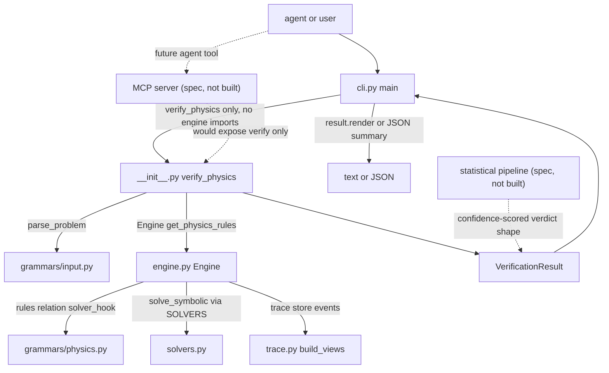

# Packaging Layers — SDK, CLI, MCP

OpenVerifiers is packaged as **three strict layers**: an SDK core, a thin CLI over it, and a designed MCP server — with the explicit boundary rule that **domain adapters must not leak the core's internals through CLI or MCP** [v1] (repo://ARCHITECTURE.md#L255-L258). The design record fixes this packaging as finalized v1 scope (repo://docs/design.md#L89-L94): the Python SDK is the core library, the CLI is a thin wrapper, and the MCP server exposes `verify()` as an agent-callable tool. This page separates what is **implemented in code** from what is **only specified** in ARCHITECTURE.md §7/§10 and README — the specs are design direction, not shipped behavior.


Caption: the three-layer boundary as shipped — CLI reaches only the public driver, the driver wires grammar extraction + engine, and the MCP server and statistical pipeline exist only as specs (dashed).

## 1. SDK core — the only layer that manipulates internals

The SDK is the layer that owns the fact/transformation model, the DAG engine, the trace store, the render projections, and the solver hooks [v1] (repo://ARCHITECTURE.md#L291-L296). Its shipped modules sit at the repository root — `model.py`, `engine.py`, `trace.py`, `solvers.py`, and the `grammars/` package — with `__init__.py` as the single public entry point.

### The public surface is `__all__` in `__init__.py`

The implemented surface differs slightly from the spec: ARCHITECTURE.md §7.1 says the SDK "exposes `Engine`, `Fact`, `Transformation`, `solve()`, `trace()`", but the built package exports exactly (repo://__init__.py#L15-L19):

```python
__all__ = [
    "Engine", "Fact", "Transformation", "VerificationResult", "Unknown",
    "verify_physics", "render_view",
    "get_physics_rules", "parse_problem",
]
```

There is **no `solve()` or `trace()`** method anywhere in the shipped code: the engine surface is `Engine.deduce(...)` and `Engine.induce(...)`, and the externalized run record is `VerificationResult` (carrying `target`, `status`, `answer`, `success_path`, `failure_trail`, `full`) [v1] (repo://engine.py#L90, repo://engine.py#L188, repo://model.py#L127-L136). The spec's `solve()`/`trace()` are design shorthand for what shipped as `deduce`/`induce` plus `build_views`/`render_view`. This `__all__` is the boundary guarantee in code: the fact store, the DAG edge sets, and the rule text are private to `Engine` (repo://engine.py#L59-L66) and are reachable through no public API. The status vocabulary (`truth`, `unverified_truth`, `derived`, `target`, `unknown`) lives in `model.py` and gates `Fact.__post_init__`, so callers cannot fabricate facts with arbitrary statuses (repo://model.py#L12-L24, repo://model.py#L46-L48).

### `verify_physics` — the domain driver

`verify_physics(problem, *, explicit=None, explicit_target=None, view="success-path")` is the SDK's domain driver and the only place that wires the whole pipeline (repo://__init__.py#L32-L58):

1. `parse_problem(problem, explicit=..., explicit_target=...)` extracts `unverified_truth` givens plus a target kind (or `None`);
2. if no target kind is identified, it short-circuits to a synthetic `UNKNOWN` `VerificationResult` whose evidence note tells the user to "phrase your target as 'find the \<quantity>'" (repo://__init__.py#L38-L52);
3. otherwise it builds `Engine(get_physics_rules())`, constructs the target fact via `make_target_fact(kind)`, and returns `engine.deduce(givens, target)`.

Engine construction and rule loading happen **inside the SDK driver, never in the CLI** — the CLI's only interaction with this pipeline is the `verify_physics` call (repo://cli.py#L38-L39). `get_physics_rules()` and `parse_problem()` are lazy adapters that import the grammar code inside the function body and delegate (repo://__init__.py#L21-L29) — domain knowledge stays in `grammars/`, and the SDK top level stays import-light.

The shipped driver accepts a `view` kwarg that it **never consults**: the returned `VerificationResult` always carries all three views, and rendering happens later, either through the package-level `render_view` (also exported) or through `VerificationResult.render(view)`, which delegates to it (repo://__init__.py#L13, repo://model.py#L138-L140, repo://trace.py#L86-L93). View selection is therefore a render-time decision, not a pipeline-time one — the CLI applies `--view` at the print step.

## 2. CLI — thin wrapper, no internals

`cli.py` implements §7.2 verbatim: "read a problem, extract facts, run the engine, print a trace… calls only the public SDK surface… keeps domain logic in the grammar, not in argv" [v1] (repo://ARCHITECTURE.md#L298-L302). `main()` does four things and nothing more (repo://cli.py#L20-L51):

1. **Parse argv** — `problem`, `--view` (argparse-restricted to `success-path|failure-trail|full`), `--explicit` (comma `k=v` overrides), `--target`, `--json` (repo://cli.py#L23-L26). An invalid `--view` value is rejected by argparse **before** the SDK ever runs.
2. **A tiny syntax transform** — splits `--explicit` on commas and `=` into a dict; no domain validation, no unit handling, no rule knowledge (repo://cli.py#L33-L37). A malformed override (e.g. non-numeric value) fails later inside `grammars/input.py`'s `float()`, not in the CLI.
3. **One SDK call** — `verify_physics(args.problem, explicit=explicit or None, explicit_target=args.target)` (repo://cli.py#L38-L39). The `--explicit`/`--target` flags map one-to-one onto the driver's `explicit`/`explicit_target` parameters, which are the escape hatch when the deterministic extractor's vocabulary misses a given (repo://grammars/input.py#L87-L99).
4. **Render or serialize** — text mode prints `result.render(args.view)`; JSON mode emits a summary: `status`, `answer` (string or `null`), `target`, and per-view event counts for `success_path`/`failure_trail`/`full` (repo://cli.py#L41-L50).

Exit contract: no problem argument prints help and returns `1`; a successful run returns `0`; `if __name__ == "__main__": sys.exit(main())` makes it a real process entry point (repo://cli.py#L29-L31, repo://cli.py#L54-L55). The CLI module's imports are just `argparse`, `json`, `sys`, and `from . import verify_physics` (repo://cli.py#L13-L17) — it never imports `engine`, `model`, or `trace`, so it cannot touch DAG internals or the rule store even by accident.

## 3. MCP server — designed, not built [v1]

ARCHITECTURE.md §7.3 specifies the MCP server: it "exposes `verify()` as an agent-callable tool… serializes the SDK result (verdict, trace, unknown flags) to JSON-RPC. No domain logic, no graph internals." The boundary guarantee is explicit: **an agent can call `verify` but never touch the fact store or rule text** (repo://ARCHITECTURE.md#L304-L309).

This is **design direction, not shipped behavior** [v1]:

- there is **no `mcp` module** anywhere in the code (the README's layer table lists `openverifiers/mcp/`, but no such directory exists);
- `cli.py` has **no `serve` subcommand** — its argument parser accepts only `problem`, `--view`, `--explicit`, `--target`, and `--json` (repo://cli.py#L23-L26, repo://README.md#L69-L74);
- README's `openverifiers serve --mcp` and its `Verifier`/`v.verify(claim, evidence)` quickstart with `SAT | UNSAT | UNCERTAIN` statuses and a `result.confidence` attribute are aspirational, not shipped API (repo://README.md#L53-L66).

When the server is built, §7.3 fixes its shape: it must sit on the SDK boundary, expose only `verify()`, and serialize the existing `VerificationResult` — no new verbs, no internals. The same `explicit`/`explicit_target` contract the CLI and benchmark use is the contract a future MCP `verify()` tool would take (repo://__init__.py#L32-L33).

## 4. Statistical / LLM-judge pipeline — designed, not built [v1]

README pitches a **dual pipeline**: deterministic symbolic verification plus a statistical LLM-judge layer for claims that do not reduce to formal constraints. ARCHITECTURE.md §10 records the sequencing decision: the **statistical pipeline is NOT implemented in the v1 vertical slice** — the slice proves the deterministic core first; "the judge itself is a stub until the symbolic core is validated… a deliberate sequencing decision, not an abandonment" (repo://ARCHITECTURE.md#L380-L389).

The one thing that *is* retained from the design is the **interface shape**: a confidence-scored verdict distinct from the symbolic verdict. In shipped code that shape shows up only as an absence — `VerificationResult` carries the discrete symbolic verdict (`status`, `answer`, three trace views) and **no confidence field exists anywhere** (repo://model.py#L127-L136), nor in the CLI JSON output (repo://cli.py#L41-L48). There is no `statistical/` module and no `confidence` symbol in the codebase. The README's architecture table — `openverifiers/symbolic/`, `openverifiers/statistical/`, `openverifiers/mcp/` — describes a layout the repository does not have; the shipped solver layer is `solvers.py` inside the SDK core, with the `SOLVERS` registry holding exactly one backend, `sympy.algebra` (repo://solvers.py#L93-L101). Snapshot-level design notes (first-class uncertainty status, PROOF/PATH objects, a standalone PATH viewer) add future direction without changing the shipped layer boundary (repo://docs/newer-additions.md#L77-L115).

## 5. The future-domain-adapter rule

The boundary rule for extension is stated once in §7.3's note and binds all future work [v1] (repo://ARCHITECTURE.md#L311-L314):

> Future domain adapters implement in `grammars/` (SDK layer only). They add rule libraries and fact schemas; they do not add CLI flags or MCP verbs for private internals. This keeps the core engine domain-agnostic… and keeps CLI/MCP stable across domains.

That rule is honored by the shipped slice by construction: every domain artifact — `grammars/physics.py` (fact-kind registry, `make_fact`, `make_rule`, `build_physics_rules`) and `grammars/input.py` (extraction) — lives under `grammars/`, and the only outward-facing additions are the SDK's two lazy adapters `get_physics_rules()` and `parse_problem()`. The engine stays rule-agnostic: it consumes a `list[Transformation]` and never names a physics quantity (repo://engine.py#L59-L71, repo://ARCHITECTURE.md#L56-L57). A new domain plugs in by supplying a rule library plus fact schema in `grammars/`; it must not grow the CLI's flag surface or invent MCP verbs.

## 6. Consumers prove the boundary

Two shipped consumers exercise the public surface and nothing else:

- **The CLI** — `cli.py` calls only `verify_physics` (repo://cli.py#L38-L39).
- **The benchmark runner** — `tests/run_benchmark.py` imports only `verify_physics`, drives it with `explicit` overrides and `explicit_target`, and judges `RESOLVED` + 1e-6 relative tolerance (repo://tests/run_benchmark.py#L13-L18, repo://tests/run_benchmark.py#L31-L38). It writes `RESULTS.md` at the repository root and returns exit code `0` only when every problem passes (repo://tests/run_benchmark.py#L60-L66). Its 20/20 result is recorded in `RESULTS.md`.

Both consumers reach domain givens through the driver's `explicit`/`explicit_target` contract rather than through engine or grammar internals — the same contract a future MCP `verify()` tool would use.

## 7. Designed-vs-built summary

| Layer | Spec (ARCHITECTURE.md / README) | Shipped (repo) | Status |
|---|---|---|---|
| SDK core (§7.1) | `Engine`, `Fact`, `Transformation`, `solve()`, `trace()` | `model.py`, `engine.py`, `trace.py`, `solvers.py`; public surface = `__all__`; engine exposes `deduce`/`induce`, result exposes three views | [v1] implemented (surface differs from spec names) |
| CLI (§7.2) | thin: parse args → call SDK → print; no DAG internals | `cli.py`: `main()` → `verify_physics` → `result.render(view)` or JSON summary | [v1] implemented |
| MCP server (§7.3) | `verify()` tool, JSON-RPC, boundary guarantee: agent never touches fact store or rule text | **not present**: no `mcp` module, no `serve` subcommand | [v1] design direction, not shipped |
| Statistical pipeline (§10) | LLM-judge; confidence-scored verdict distinct from symbolic verdict | **not present**: no `statistical` module, no confidence field in `VerificationResult` or CLI JSON | [v1] design direction, not shipped (interface shape retained) |
| Domain adapters | live in `grammars/` only; no CLI flags or MCP verbs for internals | `grammars/` + SDK adapters `get_physics_rules()`/`parse_problem()` | [v1] rule, honored by construction |

One more packaging caveat: the repository contains **no distribution manifest** — no `setup.py`, `pyproject.toml`, or `setup.cfg` — so README's `pip install openverifiers` is also aspirational (repo://README.md#L46-L49). Today the tool runs from a checkout: `python -m openverifiers.cli "<problem>"`.

## Related pages

- /openwiki/architecture/core-ontology.md — the Fact / Transformation / Unknown kinds the SDK model defines
- /openwiki/architecture/engine.md — what `verify_physics` drives: `deduce`/`induce`, DAG invariants, verdict paths
- /openwiki/architecture/trace.md — the one verbose store and the three views the CLI renders
- /openwiki/architecture/solvers.md — the single backend behind the `SOLVERS` registry the engine dispatches through