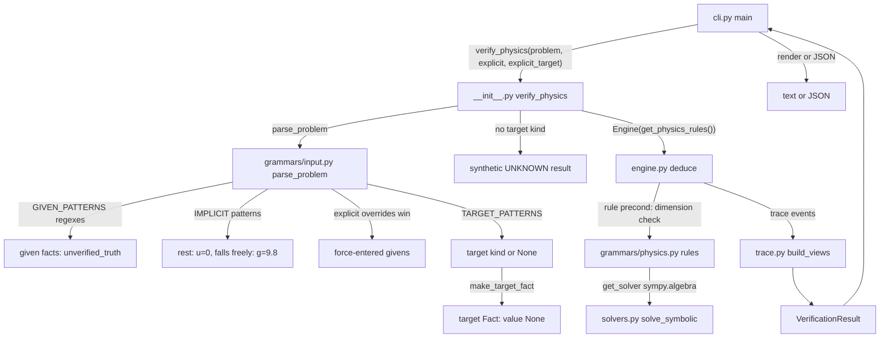

# Physics Vertical Slice — Grammar and Extraction

The physics slice is OpenVerifiers' bounded first proof: a CLI-verifiable kinematics-mechanics domain that exercises the whole pipeline — natural-language problem → schema-forced extraction → dimension-gated rules → backward deduction → trace views — with **no LLM and no fuzzy logic anywhere in the path** [v1] (repo://ARCHITECTURE.md#L320-L331, repo://grammars/input.py#L6-L9). It is composed of exactly two domain artifacts, both living in `grammars/` per the packaging rule that domain code goes nowhere else [v1] (repo://ARCHITECTURE.md#L253-L258): `grammars/physics.py` (fact-kind registry + rule library) and `grammars/input.py` (schema-forced extraction). Everything upstream of them is shared infrastructure — `model.py`, `engine.py`, `solvers.py`, `trace.py` — which stay domain-agnostic (repo://engine.py#L59-L71, repo://ARCHITECTURE.md#L56-L57).

Caption: the physics-slice pipeline from problem string to verdict — schema-forced extraction produces givens and a target kind, the engine deduces backward through dimension-gated grammar rules, and the single trace store is projected into views.

## 1. The fact-kind registry — `KIND_META`

`grammars/physics.py` opens with the domain's fact schema: `KIND_META` maps each of the nine quantity kinds to its symbol, dimension, and unit, as `{symbol, dim, unit}` (repo://grammars/physics.py#L44-L54):

| Kind | Symbol | Dimension constant | Unit |
|---|---|---|---|
| `initial_velocity` | `u` | `D_VELOCITY` | `m/s` |
| `final_velocity` | `v` | `D_VELOCITY` | `m/s` |
| `time` | `t` | `D_TIME` | `s` |
| `acceleration` | `a` | `D_ACCEL` | `m/s^2` |
| `displacement` | `s` | `D_LENGTH` | `m` |
| `mass` | `m` | `D_MASS` | `kg` |
| `force` | `F` | `D_FORCE` | `N` |
| `kinetic_energy` | `K` | `D_ENERGY` | `J` |
| `work` | `W` | `D_ENERGY` | `J` |

The dimension vocabulary comes from `solvers.py`'s {L, M, T} exponent dicts (`D_VELOCITY = {L:1, T:-1}`, `D_ACCEL = {L:1, T:-2}`, `D_FORCE = {L:1, M:1, T:-2}`, etc.) — see /openwiki/architecture/solvers.md [v1] (repo://solvers.py#L22-L29). `DEFAULT_ID` fixes a singleton id per kind (`u`, `v`, `t`, `a`, `s`, `m`, `F`, `K`, `W`): within this grammar, a fact *is* identified by its quantity symbol (repo://grammars/physics.py#L56-L60, see /openwiki/architecture/core-ontology.md).

`make_fact(kind, value, status, note)` is the single factory that stamps a fact with the four attributes the engine and preconditions rely on — `fact_kind`, `symbol`, `dimension`, `unit` — and sets `source` from the note (repo://grammars/physics.py#L74-L88). Extraction calls it with `status="unverified_truth"` (entry status for problem givens), the relation closure with `status="derived"`; the target is built separately by `make_target_fact` in `input.py` with `status=TARGET`, a `None` value, and attributes copied from `KIND_META` (repo://grammars/input.py#L125-L135).

## 2. The rule library — ten manual transformations

`build_physics_rules()` returns the ten shipped rules covering the ARCHITECTURE.md §8 subset (repo://grammars/physics.py#L136-L169, repo://ARCHITECTURE.md#L322-L326):

| Rule name | Law (sympy `relation_expr` = 0) | Input kinds | Output kind |
|---|---|---|---|
| `kinematics.v_u_at` | `v - (u + a*t)` | `u, a, t` | `final_velocity` |
| `kinematics.v2_u2_2as` | `v**2 - (u**2 + 2*a*s)` | `u, a, s` | `final_velocity` |
| `kinematics.s_ut_half_at2` | `s - (u*t + 1/2*a*t**2)` | `u, t, a` | `displacement` |
| `kinematics.s_avg_v_t` | `s - ((u+v)/2 * t)` | `u, v, t` | `displacement` |
| `kinematics.t_v_u_over_a` | `t - (v-u)/a` | `u, v, a` | `time` |
| `dynamics.F_ma` | `F - m*a` | `m, a` | `force` |
| `dynamics.a_F_over_m` | `a - F/m` | `F, m` | `acceleration` |
| `dynamics.m_F_over_a` | `m - F/a` | `F, a` | `mass` |
| `energy.KE_half_mv2` | `K - 1/2*m*v**2` | `m, v` | `kinetic_energy` |
| `energy.W_Fs` | `W - F*s` | `F, s` | `work` |

Two things make this a *manual* grammar distinct from a future auto-extracted one. First, the relations are **hand-written sympy expressions set equal to zero** (LHS − RHS over `sp.symbols("v u a t s m F K W")`), authored once and reused in both search directions — a rule is reversible by search direction, never by a parallel forward/backward pair [v1] (repo://ARCHITECTURE.md#L82-L85, repo://ARCHITECTURE.md#L107-L114). Second, the rule metadata carries `output_kind`, `input_kinds`, and `solver_hook="sympy.algebra"` (repo://grammars/physics.py#L139-L169) — the tokens that let the engine index rules by output kind and stay solver-agnostic.

## 3. `make_rule` — the dimension-enforcing rule builder

Every rule is produced by one builder, `make_rule(name, output_kind, input_kinds, relation_expr)`, which bakes in the three behaviors the slice's "done" definition demands (repo://grammars/physics.py#L91-L128):

1. **Dimension-enforcing precondition.** The generated `precondition(inputs)` first checks arity (`len(inputs) != len(input_kinds)` → `"arity: expected N inputs, got M"`), then checks each input fact's `attributes["dimension"]` against the expected kind's dimension with `dim_eq` (repo://grammars/physics.py#L102-L111). A mismatch returns a non-empty reason string — `"dimension mismatch: v (final_velocity) is {'L': 1, 'M': 0, 'T': -1}, expected ..."` — which the engine records as an `ev_reject` trace event, so rejected firings are auditable in the `failure-trail` and `full` views [v1] (repo://ARCHITECTURE.md#L326-L328, repo://engine.py#L40-L41, repo://engine.py#L150-L153).
2. **Solver-bound relation.** The `relation(inputs)` closure maps input facts to their symbols (`u`, `a`, `t`, ...) via `symbol_for(kind)`, calls `get_solver("sympy.algebra")`, and returns `make_fact(output_kind, value, status="derived", note="via <name>")` plus the solver's trace note (repo://grammars/physics.py#L113-L123). The engine never calls the solver directly — dispatch lives in this grammar closure [v1] (repo://grammars/physics.py#L118-L120, see /openwiki/architecture/solvers.md).
3. **`Transformation` assembly.** The result is a `Transformation(name, output_kind=..., input_kinds=..., precondition=..., relation=..., solver_hook="sympy.algebra", doc=...)` — the same object model the engine consumes for any domain (repo://grammars/physics.py#L125-L127, repo://model.py#L54-L92).

The single `make_fact`/`make_rule` pair is the extension boundary for this slice: adding a law is adding one `make_rule` call, and a new domain reuses the builder pattern with its own `KIND_META` — engine and CLI unchanged [v1] (repo://ARCHITECTURE.md#L56-L57, repo://ARCHITECTURE.md#L307-L314).

## 4. Extraction — deterministic, schema-forced, with explicit overrides

`grammars/input.py` turns the problem sentence into `(givens, target_kind)`. Its module docstring sets the scope and the boundary: the vocabulary is tuned to the JEE/CBSE/HSC kinematics-mechanics register and is **deliberately regex/deterministic — no LLM involved in this slice**; an LLM-assisted extraction layer is a future adapter, and the driver interface (`parse_problem(text, explicit, explicit_target)`) stays identical [v1] (repo://grammars/input.py#L6-L9).

`parse_problem` builds givens in three ordered layers, later sources never overwriting earlier ones (repo://grammars/input.py#L87-L122):

1. **Explicit overrides first, strongest** — `explicit={kind: value}` is force-entered into the givens dict before any regex runs, so it wins over both pattern matches and implicit rules (repo://grammars/input.py#L96-L99). This is the escape hatch for givens the deterministic vocabulary cannot pull from prose: the CLI's `--explicit` flag and the benchmark's `explicit_overrides` both flow into this parameter (repo://cli.py#L24, repo://cli.py#L33-L39, repo://tests/problems.py#L5-L8).
2. **`GIVEN_PATTERNS` regexes** — 20 ordered `(pattern, fact_kind)` rules over the unit vocabularies `NUM`/`U_VEL`/`U_ACC`/`U_TIME`/`U_DIST`/`U_MASS`/`U_FORCE`/`U_ENERGY`; the first match fills a kind only if not already present (repo://grammars/input.py#L24-L55, repo://grammars/input.py#L101-L105). Note the unit vocabularies tolerate common spellings (`s(?:econds?)?`, `m(?:etres?|eters)?`, `ms-2` vs `m/s^2`) and the velocity patterns use negative lookbehinds so `initial velocity` and `final velocity` phrases do not collide (repo://grammars/input.py#L37-L42).
3. **`IMPLICIT` rules** — domain common sense encoded as constant values: `starts/starting/begins/dropped/released from rest` → `initial_velocity = 0.0`; `comes/brought to rest` → `final_velocity = 0.0`; `freely/falling freely/freed from rest` and `under gravity/due to gravity/g = 9.8` → `acceleration = 9.8` (repo://grammars/input.py#L58-L64, repo://grammars/input.py#L107-L110).

The givens become facts through `make_fact(kind, val, status="unverified_truth", note="extracted from problem")` (repo://grammars/input.py#L120-L122).

### Target detection and the ambiguity contract

`TARGET_PATTERNS` is a separate ordered list of 16 `(regex, kind)` rules covering the same nine kinds — `find/calculate/determine/what is/how far/how long/...` phrasing (repo://grammars/input.py#L69-L84). Detection is **first-match-wins**: the first pattern whose regex matches the text fixes the target kind (repo://grammars/input.py#L113-L118). When auto-detection is ambiguous or misses, `explicit_target` overrides detection entirely and is also what the benchmark always passes (repo://grammars/input.py#L113, repo://tests/run_benchmark.py#L31-L38).

The deterministic scope has a crisp failure edge: the **vocabulary is beatable**. The benchmark itself documents cases where prose does not match — `kin-20` ("uniform velocity 40 m/s travels for 2 seconds") needs `explicit={"initial_velocity": 40}` because no pattern reads "uniform velocity" as a given (repo://tests/problems.py#L54, repo://tests/problems.py#L5-L8). This is by design, not a defect: the slice's contract is *determinism over recall* — ambiguous input needs explicit grounding, and the engine still verifies everything itself (repo://tests/problems.py#L5-L8, repo://grammars/input.py#L6-L9).

`make_target_fact(kind)` constructs the goal: a `target`-status `Fact` with `value=None` and attributes `{fact_kind, symbol, dimension, unit}` copied from `KIND_META` (repo://grammars/input.py#L125-L135). Because `Engine.deduce`' known-fact scan requires `value is not None` and status `truth`/`unverified_truth`/`derived`, the target never satisfies its own goal (repo://engine.py#L122-L130).

## 5. The pipeline the slice proves

The end-to-end driver is `verify_physics(problem, *, explicit=None, explicit_target=None, view="success-path")` in `__init__.py` (repo://__init__.py#L32-L58):

- `parse_problem` returns `(givens, target_kind)`; if `target_kind is None` (no pattern matched), the driver **short-circuits to a synthetic `UNKNOWN` result** — no engine run happens, and the `success_path` carries the hand-written evidence note "phrase your target as 'find the quantity'" (repo://__init__.py#L38-L52). This is the slice's `unknown`-verdict path for extraction failure (see /openwiki/architecture/engine.md).
- Otherwise: `Engine(get_physics_rules())`, `make_target_fact(kind)`, `engine.deduce(givens, target)` — **deduction only**; the shipped driver never calls `induce` for word problems [v1] (repo://ARCHITECTURE.md#L332-L334, repo://__init__.py#L54-L58).
- Multi-step composition — derive `v = u + a·t` via one rule, then feed `K = ½·m·v²` — works through the shared fact store plus per-kind memoization: the derived `v` is picked up by the known-fact scan when the energy rule needs it [v1] (repo://ARCHITECTURE.md#L330-L331, repo://engine.py#L122-L130).

The trace lives in `trace.py`. Views (`success-path`, `failure-trail`, `full`) are projections over the engine's single verbose store — derives, rejects, dead ends, joins, unknowns (repo://trace.py#L21-L73; see /openwiki/architecture/trace.md). The benchmark and CLI use the same driver and the same views (repo://cli.py#L38-L50, repo://tests/run_benchmark.py#L31-L38).

## 6. The benchmark — what "done" means, and the gate

The slice's acceptance test is `tests/problems.py` + `tests/run_benchmark.py`. Twenty JEE/CBSE/HSC word problems carry `(id, text, target_kind, expected_answer, explicit_overrides)` and span all four proof patterns plus dynamics and energy (repo://tests/problems.py#L11-L78). The runner calls `verify_physics(text, explicit=explicit or None, explicit_target=target)` and marks a pass only when `status == "RESOLVED"` *and* the answer is within 1e-6 relative tolerance; an `UNKNOWN` verdict counts as a fail — the benchmark demands a resolved number (repo://tests/run_benchmark.py#L21-L27, repo://tests/run_benchmark.py#L31-L38). It rewrites `RESULTS.md` at every run and exits `0` only when all twenty pass (repo://tests/run_benchmark.py#L60-L66). The current record is **20/20** (repo://RESULTS.md#L5-L7).

The benchmark doubles as the **trust boundary against auto-extraction** [v1]. ARCHITECTURE.md §5.2 defines the gate: a candidate auto-extracted grammar "passes" only if, on a curated suite of must-solve and must-reject cases, it solves every must-solve case, **rejects** every must-reject case with `unknown`/no-solution (never a wrong number), produces fully traceable derivations, and demonstrably enforces its checks — and a grammar failing any must-condition is discarded or sent back for revision (repo://ARCHITECTURE.md#L193-L217). The rationale is blunt: "a wrong rule is worse than no rule" [v1] (repo://ARCHITECTURE.md#L219-L222).

The shipped slice sits **on the manual side of that gate** [v1]:

- the grammar is manual / hand-authored — auto-extraction is future work, benchmark-gated [v1] (repo://ARCHITECTURE.md#L187-L191, repo://docs/design.md#L74-L80);
- the benchmark's pass record is for the manual grammar, not for any generated one (repo://RESULTS.md#L5-L7);
- the benchmark itself has no must-reject cases in v1 — its twenty entries are all must-solve, and the runner counts `UNKNOWN` as a fail, so the §5.2 gate's rejection leg is **not exercised by the shipped harness** [open] (repo://tests/problems.py#L80-L81, repo://tests/run_benchmark.py#L31-L38). The curation gap — what makes a must-solve/must-reject suite "good enough" — is an explicitly open question [open] (repo://ARCHITECTURE.md#L362-L365).

## 7. Invariants, failure semantics, and scope

Invariants that hold by construction for every slice run:

- **Every derived fact carries the expected dimension.** The precondition is the only gate; its rejection reason is recorded, never silently dropped (repo://grammars/physics.py#L102-L111, repo://engine.py#L150-L153).
- **No wrong-number outputs from the solver.** When `sp.solve` raises or returns no roots, `solve_symbolic` returns `(None, note)`; the fact becomes `derived` with `value=None`, which can never satisfy the known-fact scan nor resolve a benchmark answer — the outcome is a failed derivation, not a fabricated number [v1] (repo://solvers.py#L66-L70, repo://engine.py#L122-L130, see /openwiki/architecture/solvers.md).
- **The physics magnitude convention.** For multi-root relations (e.g. `v² = u² + 2as`), the solver prefers the minimum positive real root — textbook problems expect the magnitude [v1] (repo://ARCHITECTURE.md#L328-L331, repo://solvers.py#L71-L81). The benchmark depends on it: `kin-13` and `kin-14` pass only because negative roots are discarded (repo://tests/problems.py#L40-L47).
- **Circularity is impossible by construction.** Deduction carries a `visiting` kind set (a rule whose input kind is already on the path is rejected as circular) and the ancestor guard rejects any output that is an ancestor of its inputs (repo://engine.py#L110-L112, repo://engine.py#L161-L165).

Failure semantics: a missing given yields `UNKNOWN` with evidence ("add a missing given or rule"); a missing target kind yields the synthetic `UNKNOWN` with the "phrase your target as" note (repo://engine.py#L102-L104, repo://__init__.py#L38-L52). Extensions to the slice — more laws, more quantity kinds, a different domain — touch only `grammars/` plus possibly a new solver registry entry; nothing in the core changes [v1] (repo://ARCHITECTURE.md#L307-L314).

Explicitly **out of scope for v1** [out-v1]: auto-extraction (benchmark-gated), the statistical/LLM-judge pipeline (a stub until the symbolic core is validated), minimal universal root logic, non-physics domains, and any UI beyond the CLI (repo://ARCHITECTURE.md#L345-L350, repo://ARCHITECTURE.md#L380-L389).

## 8. Relationship to other pages

This page is the domain-down view of the vertical slice. The horizontal views live in the architecture set: /openwiki/architecture/layers.md (the SDK driver `verify_physics` and the three-layer boundary), /openwiki/architecture/engine.md (how `deduce` resolves the target kind through the rule index), /openwiki/architecture/solvers.md (the dimension algebra and the sympy.algebra backend this grammar consumes), /openwiki/architecture/trace.md (what the recorded events become), and /openwiki/architecture/core-ontology.md (the fact/transformation model `make_fact` and `make_rule` instantiate). The benchmark harness is the operational proof in /openwiki/operations/benchmark.md, and the verify-claim workflow is the user-facing seam in /openwiki/workflows/verify-claim.md.

## 9. Focused tests that matter

There is one test harness in the shipped repo — `tests/run_benchmark.py` over `tests/problems.py` — and it is the slice's contract. It matters because it exercises the integration in one pass: extraction (regex + implicit + explicit), target detection (`explicit_target` is always passed), engine deduction per kind, dimension preconditions, the sympy solver with the magnitude convention, trace-view construction, and RESULTS.md regeneration (repo://tests/run_benchmark.py#L31-L66). The `assert len(BENCH) == 20` guards the suite against silent shrinkage (repo://tests/problems.py#L80-L81). Unit-level coverage of `make_fact`, `make_rule` preconditions, or the regex tables is **not** shipped; those behaviors are only exercised through the benchmark path today.