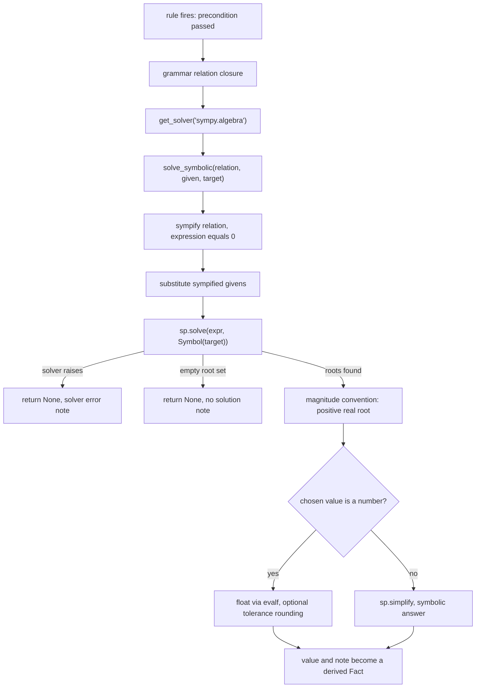

# Solver Hooks and Dimension Checking

`solvers.py` owns two responsibilities that sit between the engine and the domain grammar. First, the **dimension algebra**: the tiny linear basis `{L, M, T}` implemented as exponent dicts, which rule preconditions use to reject dimensionally wrong firings. Second, the **solver registry and backends**: a rule's `relation` is resolved by a backend hook, and the only backend registered in v1 is `sympy.algebra`, a wrapper over sympy's algebraic solve [v1] (repo://solvers.py#L1-L10). The layer's stated design contract is to stay backend-agnostic — "the core engine never imports sympy directly" [v1] (repo://solvers.py#L6-L9) — and ARCHITECTURE.md §1.2 fixes the shape: a transformation carries a `solver_hook` token, and the engine calls `precondition`, then `relation` via that hook, staying rule-agnostic (repo://ARCHITECTURE.md#L43-L57).

Caption: the solve path from rule firing to a derived fact — registration lookup, sympify-and-substitute, `sp.solve`, the failure contract, the magnitude convention, and numeric-versus-symbolic selection (repo://solvers.py#L50-L90, repo://grammars/physics.py#L113-L123).

## Dispatch path: the engine's hands stay clean

The call chain is `Engine` → `Transformation.apply(inputs)` → the grammar's `relation` closure → `get_solver("sympy.algebra")` → `solve_symbolic(relation_expr, given, target_sym)` (repo://model.py#L85-L92, repo://grammars/physics.py#L113-L123). Two details matter:

- The **engine never calls the solver directly**. It imports `get_solver` from `solvers.py` (repo://engine.py#L29), but the v1 dispatch lives in the grammar: `make_rule` bakes a `relation` closure that resolves the hook token itself on every firing (repo://grammars/physics.py#L118-L120). The engine only sees `(output_fact, trace_note)` from `rule.apply`.
- The solver's **return note is discarded at the engine boundary in v1**: both deduction and induction unpack `out_fact, _note = rule.apply(inputs)` and never write the note into the trace event (repo://engine.py#L155-L159, repo://engine.py#L208-L212). The note travels only as far as the returned tuple; see the failure contract below for what happens on failure.

## Dimension algebra — {L, M, T} exponent dicts

A dimension is an ADT: a dict mapping basis symbols to exponents, over the three-dimension basis **L** (length), **M** (mass), **T** (time) (repo://solvers.py#L17-L21). The algebra is deliberately minimal:

- `dim_add(a, b)` — pointwise sum of exponents, dropping any basis symbol whose resulting exponent is zero, so `{"L": 1, "T": -1}` added to `{"T": 1}` yields `{"L": 1}` (repo://solvers.py#L32-L36).
- `dim_sub(a, b)` — `dim_add(a, negated b)` (repo://solvers.py#L39-L40).
- `dim_eq(a, b)` — equality **after dropping zero exponents** (repo://solvers.py#L43-L44). Missing keys therefore equal exponent 0: a dimensionless `{"L": 0, "M": 0, "T": 0}` equals `{}` equals `DIM`, and dicts compare order-insensitively.

The shipped constants are the whole vocabulary the physics grammar uses (repo://solvers.py#L22-L29):

| Constant | Exponents | Dimension |
|---|---|---|
| `DIM` | `{L:0, M:0, T:0}` | dimensionless |
| `D_LENGTH` | `{L:1}` | length |
| `D_TIME` | `{T:1}` | time |
| `D_VELOCITY` | `{L:1, T:-1}` | velocity |
| `D_ACCEL` | `{L:1, T:-2}` | acceleration |
| `D_FORCE` | `{L:1, M:1, T:-2}` | force |
| `D_MASS` | `{M:1}` | mass |
| `D_ENERGY` | `{L:2, M:1, T:-2}` | energy |

The physics grammar maps every fact kind to one of these in `KIND_META` (e.g. `final_velocity → D_VELOCITY, unit m/s`, `kinetic_energy → D_ENERGY, unit J`) and stamps the dimension into every fact's `attributes["dimension"]` at construction (repo://grammars/physics.py#L44-L54, repo://grammars/physics.py#L74-L88).

### Where the algebra is enforced — rule preconditions

`make_rule` generates a precondition that first checks input arity, then checks each input fact's `attributes["dimension"]` against the expected kind's dimension with `dim_eq`; a mismatch returns a non-empty reason string — `"dimension mismatch: v (final_velocity) is {'L': 1, 'M': 0, 'T': -1}, expected ..."` (repo://grammars/physics.py#L102-L111). That reason is exactly what ARCHITECTURE.md §8 demands: "Dimension checking enforced on every rule — rejected steps record the rejected reason ('dimension mismatch')" [v1] (repo://ARCHITECTURE.md#L326-L328). The engine records any non-`None` reason as an `ev_reject` trace event, so a dimensionally wrong firing is auditable in the `failure-trail` and `full` views (repo://engine.py#L40-L41, repo://engine.py#L150-L153). The precondition contract itself — return `None` to allow firing, a reason string to reject — is specified in `model.py` (repo://model.py#L57-L64; see /openwiki/architecture/core-ontology.md).

## The sympy.algebra backend — `solve_symbolic`

`solve_symbolic(relation, given, target, tolerance=None)` solves `relation == 0` for the symbol `target` using the known values in `given`, returning `(value, note)` where value is a Python float/int/str when numeric or a sympy expression when symbolic (repo://solvers.py#L50-L56). The steps (repo://solvers.py#L57-L90):

1. **Normalize** — `sp.sympify(relation)`. The relation is a sympy expression set equal to zero (LHS − RHS), e.g. `v - (u + a*t)`; the physics grammar builds these at rule-library time with `sp.symbols("v u a t s m F K W")` (repo://grammars/physics.py#L136-L169, repo://solvers.py#L57-L58).
2. **Substitute givens** — every given value is `sp.sympify`-ed and substituted for its symbol, keys being the grammar's symbol names (`u`, `a`, `t`, …) mapped from fact kinds in the relation closure (repo://solvers.py#L59-L63, repo://grammars/physics.py#L113-L117).
3. **Solve** — `sp.solve(expr_s, sp.Symbol(target))` inside a try/except, because the solver can raise on non-algebraic shapes (repo://solvers.py#L64-L68).
4. **Pick a root** — see the magnitude convention below (repo://solvers.py#L71-L81).
5. **Prefer numeric** — if the chosen value `is_number`, convert with `float(evalf())`; if a `tolerance` was passed, round to `int(abs(log10(tolerance)))` decimal places and note `"numeric {rounded}"`, else note `"numeric {val_f}"`. Otherwise return `sp.simplify(val)` with note `"symbolic {simplified}"` (repo://solvers.py#L82-L90).

The `tolerance` parameter is dormant API in v1: the physics relation closure calls the solver with exactly three arguments and never passes it (repo://grammars/physics.py#L118-L120), so in the shipped slice answers always come back as unrounded floats.

### The physics magnitude convention [v1]

When a relation has multiple roots — `v² = u² + 2·a·s` yields `±` roots — the backend resolves to the **positive real root**, choosing the minimum positive real value: it filters the solution set to real roots, keeps those with `evalf() > 0`, takes `min`, falls back to the first real root if none is positive, and to the first solution if nothing is real (repo://solvers.py#L71-L81). ARCHITECTURE.md §8 frames this as the physics slice's convention: "the algebra solver applies the physics magnitude convention for velocity-like targets: a multi-valued root set resolves to the positive real root (textbook problems expect the magnitude)" [v1] (repo://ARCHITECTURE.md#L328-L331). Note the implementation applies the preference to whatever target the grammar solves — the rationale is velocity-like targets (e.g. `final_velocity` from `kinematics.v2_u2_2as`), and the benchmark depends on it: `kin-13` (u=3, a=2, s=4 → v = +5) and `kin-14` (dropped from rest, 4.9 m → v = +9.8) pass only because the negative roots are discarded (repo://tests/problems.py#L40-L47, repo://RESULTS.md#L11-L14). It is a [v1] convention for this slice, not a general rule for all possible hook backends.

## Failure contract — no solution or solver error

The backend's failure contract is explicit and tuple-shaped (repo://solvers.py#L65-L70):

- **Solver exception** — `sp.solve` raises on non-algebraic shapes → `(None, "solver error: {exc}")`.
- **Empty solution set** — the relation is unsatisfiable or inconsistent with the givens → `(None, "no solution: relation unsatisfiable or inconsistent with givens")`.

How far the failure propagates in the shipped wiring (repo://model.py#L85-L92, repo://engine.py#L150-L159):

- The engine wraps `rule.apply(inputs)` in try/except and records `ev_reject` with reason `"relation error: {exc}"` whenever the relation raises — this is the rejection-reason path in the trace for solver-induced failures, auditable via the failure-trail render (`REJECT <rule> (inputs ...): relation error: ...`) (repo://engine.py#L155-L159, repo://trace.py#L100-L102).
- The scripted `(None, note)` branch does not raise: the grammar's relation closure packages whatever value comes back into a derived fact — `make_fact(output_kind, None, status="derived", ...)` — and the per-call note is discarded by the engine's `_note` unpacking (repo://grammars/physics.py#L120-L123, repo://engine.py#L156). A `None`-valued derived fact can never satisfy the deduction known-fact scan (which requires `value is not None`), nor resolve a numeric benchmark answer, so the outcome stays "not a wrong number" rather than a fabricated result (repo://engine.py#L122-L126). Threading the solver's structured note from the relation closure into the trace as an `ev_reject` reason is a v1 boundary gap relative to the contract, not a shipped behavior.

## Registry and dispatch — `SOLVERS` and `get_solver`

The registry maps a hook token to a callable of shape `(relation, given, target) -> (value, note)` (repo://solvers.py#L93-L96):

- `SOLVERS = {"sympy.algebra": solve_symbolic}` — **exactly one backend registered in v1**. ARCHITECTURE.md §1.2 names `z3.sat` and custom hooks as conceptual possibilities ("sympy.algebra, z3.sat, or a custom hook"), but no z3 backend is registered or shipped (repo://ARCHITECTURE.md#L52-L53); the only solver backend that exists in the repository is sympy algebra [v1].
- `get_solver(hook)` returns the callable or raises `ValueError("unknown solver hook ...; known: [...]")` — the unknown-hook error lists the registered tokens (repo://solvers.py#L99-L102). Because every physics rule declares `solver_hook="sympy.algebra"` and the relation closure resolves the token at rule-firing time, a misspelled or unregistered hook fails loudly mid-run with a `ValueError` naming the known hooks; there is no silent fallback (repo://grammars/physics.py#L125-L127, repo://grammars/physics.py#L118-L120).

## Extension points and configuration

- **New solver backend**: register a callable under a new token in `SOLVERS`, and have grammar relations that use it declare the token in `solver_hook`. The core stays solver-agnostic by construction — the engine never imports sympy (repo://solvers.py#L1-L10, repo://engine.py#L29).
- **New grammar/domain**: reuse `dim_add`/`dim_sub`/`dim_eq` and the shipped dimension constants in rule preconditions, or extend the basis; preconditions remain the single gate where dimensions are checked and rejections are recorded (repo://grammars/physics.py#L102-L111).
- **Tolerance rounding** is present in the backend signature for numeric answers but unused by the physics grammar in v1 (repo://solvers.py#L82-L88).

## Validation against the benchmark

The 20-problem JEE/CBSE/HSC benchmark exercises the full solve path — `verify_physics` → deduction → rule relations → `solve_symbolic` — and passes an answer only when status is `RESOLVED` and the result is within 1e-6 relative tolerance of the known correct value (repo://tests/run_benchmark.py#L21-L27, repo://__init__.py#L32-L58). Current record: **20/20 passing** (repo://RESULTS.md#L5-L7, docs://design.md#L96-L102), with the magnitude convention and numeric float answers doing the visible work (all twenty answers arrive as floats such as `10.0`, `29.4`, `9.8`).

## Open questions touching the solver layer

- **Numerical vs symbolic grounding** [open]: the slice is symbolic (sympy); whether/when to ground derived facts with numerical solvers when the target requires a value is explicitly an open choice, not a committed decision (repo://ARCHITECTURE.md#L373-L376).
- **Failure-note threading** [open-adjacent]: the `(None, note)` contract is not yet surfaced into the trace as a rejection reason at the engine boundary (see the failure contract above) — the recorded reason appears only for exceptions (`"relation error: ..."`).

## Related pages

- /openwiki/architecture/core-ontology.md — the Fact / Transformation / Unknown kinds, and the precondition contract this layer's dimension checks feed
- /openwiki/architecture/engine.md — how deduction/induction call `rule.apply` and record rejections around solver results
- /openwiki/concepts/physics-grammar.md — the shipped grammar that consumes the dimension constants and the sympy.algebra hook
- /openwiki/concepts/unknown-verdict.md — why an unsatisfied target (e.g. missing given) is `UNKNOWN`, not a wrong number
- /openwiki/workflows/authoring-a-grammar.md — how a new domain declares fact kinds with dimensions and rules with solver hooks