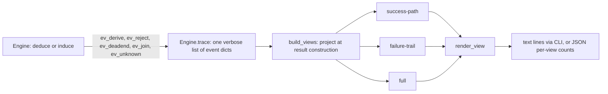

# Trace Store and Render Views

OpenVerifiers records every step of a verification run into **one verbose event store** and derives all human-facing output from it. The policy is fixed [v1] (repo://ARCHITECTURE.md#L148-L174, docs://design.md#L69-L72): the engine appends every `derive`, `reject`, `deadend`, `join`, and `unknown` event to a single list — `Engine.trace` — and nothing is thrown away at search time. `trace.py` implements the projection half of the policy: `build_views` filters that one store into the three views (success-path, failure-trail, full) when the `VerificationResult` is constructed, and `render_view` formats whichever view a caller asks for. The three views are **projections over the one store, never separate structures** [v1] (repo://ARCHITECTURE.md#L162-L174): because every event already carries its success or rejection label, all three views are deterministic functions of the single recorded history.


Caption: the one-store trace flow — the engine appends five event kinds into a single `Engine.trace` list, `build_views` projects the three views from it when the result is built, and `render_view` (or `VerificationResult.render`) formats one of them (repo://engine.py#L35-L53, repo://trace.py#L21-L73, repo://trace.py#L86-L110).

## 1. The one-verbose-store policy

ARCHITECTURE.md §4.1 is explicit about storage: **full verbose** — every path explored (each transformation firing), every node created (including derived facts later unused), every dead end with its reason, every rejected transformation (precondition failure, dimension mismatch, …) with its *why*, all in the same underlying graph; "There is one store. Nothing is thrown away at search time" [v1] (repo://ARCHITECTURE.md#L150-L160). The canonical design record fixes this trace policy as finalized v1 (docs://design.md#L69-L72), and §4.2 completes it with the render rule: filter the verbose store into the three views at render time, from the same recorded history, "There is no second trace structure" (repo://ARCHITECTURE.md#L162-L174).

In code the store is `Engine.trace: list[dict]`, initialized empty in `Engine.__init__` alongside the fact store, the DAG edge sets, and the per-kind memo (repo://engine.py#L59-L63). Every event kind has a dedicated `ev_*` builder in `engine.py`, and each appends to the same list — there is no per-view or per-kind accumulation. The derive append is centralized in `_record_derive`, which records the event **and** maintains the `_parents`/`_children` edge sets in the same place, so the graph structure and the audit trail can never diverge (repo://engine.py#L83-L87).

One lifecycle subtlety: `trace` is engine-lifetime state, not run-lifetime state. `deduce` resets `_memo` at the start of each run (repo://engine.py#L94-L96) but never clears `trace`, so reusing one `Engine` across multiple runs appends every run's events into the same store. Shipped usage avoids this by constructing a fresh `Engine` per problem inside `verify_physics` (repo://__init__.py#L54-L58), which makes the trace effectively per-run and keeps each result's views self-contained. A batch driver that reuses an `Engine` would need to account for the accumulation.

## 2. The five trace event shapes

The engine emits **exactly five event shapes** into the store, built by the `ev_*` helpers (repo://engine.py#L35-L53). ARCH §4's derive/reject/deadend/join/unknown list maps one-to-one onto these builders; no other event type exists in the code.

| type | fields emitted | when it is appended |
|---|---|---|
| `derive` | `fact_id`, `fact_value` (str), `rule`, `inputs` (list of input fact ids) | a rule fired and produced a fact — via `_record_derive` (repo://engine.py#L35-L37, repo://engine.py#L83-L87) |
| `reject` | `rule`, `inputs`, `reason` | a candidate firing is refused and its *why* is kept (below) |
| `deadend` | `fact_kind`, `reason` | a fact kind cannot be resolved — max depth, an unresolvable input needed by a rule, or no rule/known fact (repo://engine.py#L44-L45) |
| `join` | `fact_id`, `sources` | independent paths collapse onto one fact node (below) |
| `unknown` | `fact_id`, `reason`, `evidence` | the target cannot be derived; terminal event with an evidence hint (repo://engine.py#L52-L53) |

The five builders (repo://engine.py#L35-L53):

```python
def ev_derive(fact: Fact, rule: str, inputs: list[Fact]) -> dict:
    return {"type": "derive", "fact_id": fact.id, "fact_value": str(fact.value),
            "rule": rule, "inputs": [f.id for f in inputs]}

def ev_reject(rule: str, inputs: list[Fact], reason: str) -> dict:
    return {"type": "reject", "rule": rule, "inputs": [f.id for f in inputs], "reason": reason}

def ev_deadend(kind: str, reason: str) -> dict:
    return {"type": "deadend", "fact_kind": kind, "reason": reason}

def ev_join(fact_id: str, sources: list[str]) -> dict:
    return {"type": "join", "fact_id": fact_id, "sources": sources}

def ev_unknown(fact_id: str, reason: str, evidence: str = "") -> dict:
    return {"type": "unknown", "fact_id": fact_id, "reason": reason, "evidence": evidence}
```

Notable semantics:

- **derive events carry fact ids, not kinds** — `fact_id`, stringified `fact_value`, the `rule` name, and `inputs` as a list of input fact ids. This is exactly what lets `build_views` walk the path backwards (§3). A derived `fact_value` is serialized with `str()` at record time, so the trace is stable even when the value is a sympy expression (repo://engine.py#L35-L37).
- **reject events record the *why*** — precondition reason strings ("dimension mismatch", "arity: expected …"), `"relation error: …"` when `rule.apply` raises, and the two circularity guards: `"circular: kind … already on path"` from the deduction visiting set (repo://engine.py#L110-L112) and `"circular: … in ancestors of inputs"` from the ancestor guard (repo://engine.py#L161-L165). Induction records precondition and relation-error rejects per candidate (repo://engine.py#L203-L212), with one asymmetry — the **one asymmetry in the event stream**: a circular candidate in induction is skipped silently rather than recorded as a rejection. Grammar-level rejections are auditable through these events: the physics rule precondition returns a non-empty reason string for arity or dimension mismatch, the engine records any non-None reason as an `ev_reject`, so dimensionally wrong firings appear in the failure-trail and full views (repo://grammars/physics.py#L102-L111, repo://ARCHITECTURE.md#L326-L328).
- **the solver's returned note is discarded at the engine boundary** — both modes unpack `out_fact, _note = rule.apply(inputs)` and never write the note into the trace, so the note reaches the trace only as an exception path's `relation error:` reject reason (repo://engine.py#L155-L159, repo://engine.py#L208-L212).
- **deadend events carry `fact_kind`, not `fact_id`** — a dead end is a *kind* that could not be resolved, which is why the success-path fallback matches deadends by kind rather than by id (§3). Deadends fire for max depth (`"max depth exceeded"`, repo://engine.py#L113-L115), for an unresolvable input needed by a rule (`"needed for rule …"`, repo://engine.py#L142-L144), and for exhaustion (`"no rule or known fact"`, repo://engine.py#L172-L174).
- **join events mark dedup-collapse** — in deduction, when several known facts of the target kind exist, `ev_join(kind, [ids…])` is recorded before memoizing the first candidate (repo://engine.py#L127-L129); in induction, when a rule fires but `add_fact` finds the output already known, `ev_join` is recorded instead of a duplicate derive (repo://engine.py#L213-L220).
- **unknown events are terminal** — appended by `deduce` when no rule could derive the target (`"no rule could derive the target from available givens"`, evidence hint `"add a missing given or rule"`) and by `induce` on closure without the target (`"no rule produced the target"`) (repo://engine.py#L102-L104, repo://engine.py#L227-L231). The `evidence` field is optional and rendered only when present (§4).

One more derive variant: when deduction succeeds, `deduce` appends a synthetic derive event with `rule == "TARGET-REACHED"` whose inputs are the givens in the target's parent set, before building the `RESOLVED` result (repo://engine.py#L98-L100). `build_views` treats this event specially (§3).

## 3. build_views — projections, not separate storage

`build_views(trace, target_id, answer) -> (success, failure, full)` is the only place the three views are produced from an engine trace (repo://trace.py#L21-L73; the one exception, a no-engine-run short circuit, is in §5). It is called once, at result construction: `Engine._result` invokes it with `self.trace`, the target id, and the answer, and the returned lists are stored on the `VerificationResult` as `success_path`, `failure_trail`, and `full` (repo://engine.py#L252-L256, repo://model.py#L127-L136).

- **`full`** is the views' ground truth: a shallow copy of the store, `full = list(trace)`, preserving recorded order (repo://trace.py#L24). Every other view is derived from it.
- **`success`** reconstructs the path that reached the target. It is not stored separately — it is recomputed from the derive events each run.
- **`failure`** starts from `success` and appends the rejected/dead/unresolved events (below).

### How the success path is reconstructed

`build_views` approximates "the path" as the chain implied by derive events — every derive whose output lies on the dependency closure of the target answer — an honest approximation the code's own comment acknowledges (repo://trace.py#L26-L30):

1. **Find the producer(s) of the target.** It first looks for derive events with `fact_id == target_id` whose `rule` is *not* `TARGET-REACHED` — the real derivation; if none exist it falls back to including the `TARGET-REACHED` event (repo://trace.py#L33-L36). For a problem whose answer came straight from givens, only the synthetic event matches.
2. **Walk backwards through inputs.** An index `by_out` maps every derived `fact_id` to the derive events that produced it. Starting from the last producer, the walk pops an event, appends it to `success`, and pushes every derive event that produced one of the event's `inputs`; a `seen` set of event object ids prevents revisits (repo://trace.py#L44-L59). Because the engine's DAG forbids cycles by construction (see /openwiki/architecture/engine.md), the walk terminates.
3. **Reverse.** The walk accumulates from the target back to the givens; `success.reverse()` restores derivation order (repo://trace.py#L60). Multi-step derivations (e.g. `v = u + a·t` then `K = ½·m·v²`) chain naturally: the second rule's derive cites `v` as an input, and the walk finds the first rule's derive as its producer.

### The fallback when no producer exists

When the target has **no derive producer at all** — it is a given fact, or the run ended `UNKNOWN` — `build_views` does not fabricate a chain. It scans the trace for terminal events about the target and emits those instead: events of type `unknown` or `deadend` whose `fact_id` equals `target_id`, **or** whose `fact_kind` equals `_find_target_kind(trace)` — the kind of the first deadend in the store (repo://trace.py#L37-L43, repo://trace.py#L76-L80). Since deadends carry `fact_kind` and not `fact_id`, the kind match is what lets an unresolved target's deadends appear on its success path. For an `UNKNOWN` verdict this is usually the single `ev_unknown(target.id, …)` terminal event; the reconstruction is honest about the outcome rather than pretending a path exists.

### failure-trail — success plus the rejected and dead branches

`failure = list(success)`, then every `reject`, `deadend`, and `unknown` event is appended in trace order; a final pass filters by object identity such that all success events are retained (repo://trace.py#L64-L71). The resulting view is exactly the success events plus the rejected/dead/unresolved branches — every event in the failure trail is either on the success path or is a reject/deadend/unknown from the store. Two honest details:

- **join events are not in the failure trail** — the projection appends only `("reject", "deadend", "unknown")`. Per ARCH §4.2 the failure trail is "the success path **plus** the rejected/dead branches and their reasons" (repo://ARCHITECTURE.md#L167-L170); joins are neither. Joins appear in `full` and in `success` only if they were on the success chain (which the construction never produces).
- **the dedupe is defensive, not a set-dedup** — it keeps an appended event unless its object id is already in `success` *and* the object is not a success event, which the construction makes effectively impossible; coexisting equal-valued events are not collapsed.

## 4. render_view — the single text renderer

`render_view(view, result)` is the one function that formats a view into human-readable text (repo://trace.py#L86-L110). It resolves the requested view name against the `VerificationResult` (`success-path` → `result.success_path`, `failure-trail` → `result.failure_trail`, `full` → `result.full`) and raises `ValueError(f"unknown view …")` for anything else — so an invalid view name that slips past the CLI's argparse restriction is caught here (repo://trace.py#L87-L93).

The output format is line-oriented and deterministic:

```
[OpenVerifiers] target={result.target} status={result.status} answer={result.answer}
  derive {fact_id} = {fact_value}  via {rule}  from {inputs}
  REJECT {rule} (inputs {inputs}): {reason}
  deadend {fact_kind or '?'}: {reason}
  join {fact_id} from {sources}
  UNKNOWN {fact_id}: {reason} — evidence needed: {evidence}   # only when evidence is present
```

Derives are lowercase and show the event's `fact_id`, stringified value, rule, and input ids; rejects are uppercase `REJECT` with the recorded reason; deadends show their kind (or `'?'` if absent) and reason; joins show the collapsed fact and its sources; unknowns are uppercase `UNKNOWN` with the reason and, when the event carries one, an `evidence needed:` suffix (repo://trace.py#L96-L109).

`render_view` is the **single render path** used by every caller: it is exported from the package (`__all__`), `VerificationResult.render(view)` delegates to it, and the CLI prints `result.render(args.view)` in text mode (repo://__init__.py#L13-L17, repo://model.py#L138-L140, repo://cli.py#L50).

## 5. View selection is a render-time decision

The engine always computes all three views, so nothing about the run changes with the requested view. The CLI restricts `--view` to `success-path|failure-trail|full` via argparse (default `success-path`) and applies the choice only at the print step (repo://cli.py#L23, repo://cli.py#L50); in JSON mode it emits `status`, `answer` (string or `null`), `target`, and per-view **event counts** for the three lists — a compact summary instead of the full text trace (repo://cli.py#L41-L48). The SDK driver's `view` kwarg is accepted but never consulted: `verify_physics` returns the fully-populated `VerificationResult` either way, and `render_view` is applied later.

One shipped path builds views **without** `build_views`: when `parse_problem` cannot identify a target kind, `verify_physics` short-circuits to a synthetic `UNKNOWN` `VerificationResult` whose `success_path` is a hand-written literal list containing a single `unknown` event ("no target kind identified in problem", evidence "phrase your target as 'find the \<quantity>'") and whose `failure_trail`/`full` are empty (repo://__init__.py#L38-L52). It is the only shipped result whose views do not come from an engine trace — a deliberate edge case, since there was no engine run to trace.

Test coverage note: no shipped test asserts trace-view contents directly. The benchmark runner `run_benchmark.py` asserts only that each problem's status is `RESOLVED` and the answer is within tolerance (repo://tests/run_benchmark.py#L30-L38), so the views are exercised as a side effect of the engine's deterministic event emission rather than as a separate assertion surface; per-view counts are exposed through `VerificationResult.summary()` (repo://model.py#L142-L150) and the CLI's JSON mode.

## 6. Scaling caveat — [open]

The full-verbosity store is **unbounded on large search spaces**: storing every path and rejection grows without bound as the search grows. ARCHITECTURE.md §9 item 1 records as deliberately unresolved — [open] — *when and how to rotate, summarize, or time-box verbose ingestion while preserving audit integrity*; the current stance is to assume problem-scale usage where the full store is fine (repo://ARCHITECTURE.md#L358-L361). Nothing in `trace.py`, `engine.py`, or the CLI implements rotation, sampling, or summarization today, and any resolution would land here, in `trace.py` and ARCHITECTURE.md §4. This page documents the policy as shipped ([v1]) and the scaling question as open — do not "resolve" it prematurely in code.

## Related pages

- /openwiki/architecture/engine.md — the deduction/induction engine that emits the five event shapes into `Engine.trace`
- /openwiki/architecture/core-ontology.md — the Fact/Transformation/Unknown kinds the events refer to
- /openwiki/architecture/layers.md — where `build_views`/`render_view` sit in the SDK/CLI boundary and the spec-vs-built surface
- /openwiki/architecture/solvers.md — the solver hooks whose outputs and errors surface as derive values and relation-error rejects
- /openwiki/workflows/verify-claim.md — the end-to-end problem → verdict flow that ends in these views