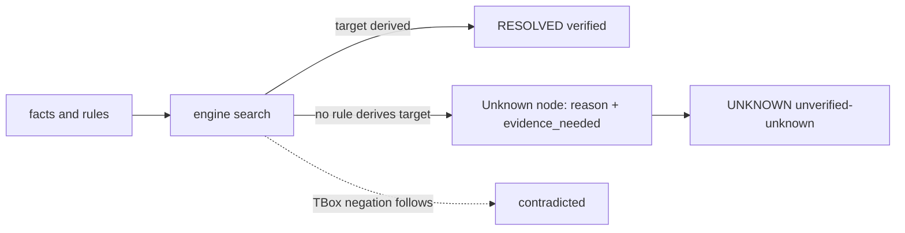
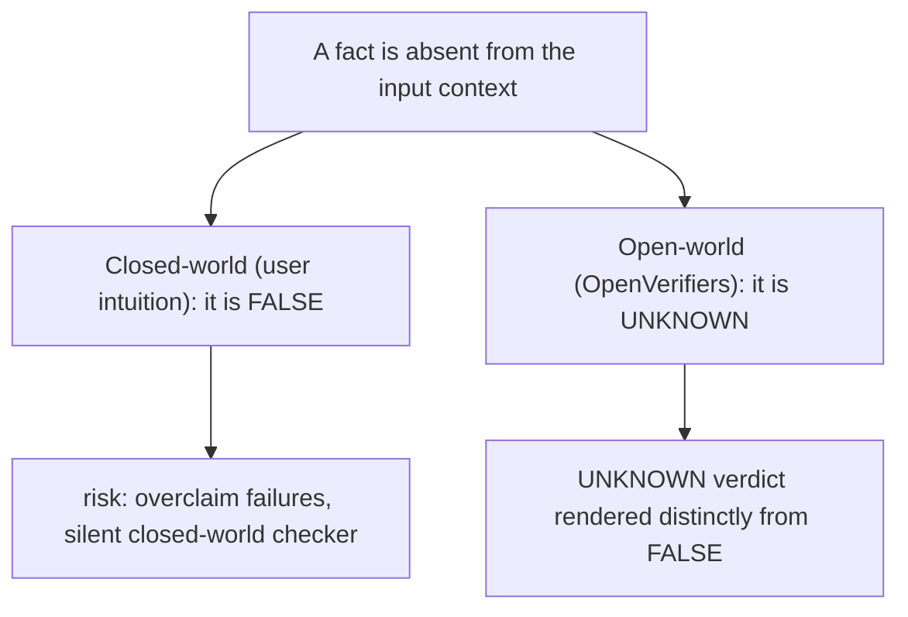

# First-Class Unknown and Open-World Semantics

OpenVerifiers treats **"cannot currently determine"** as a first-class, legitimate
outcome — not an error, not a silent skip, and *never* the same as "false". This
page documents the `Unknown` node as an auditable result, the **Open-World
Assumption (OWA)** semantics that justify it (grounded in Description Logic
research), the verdict vocabulary it implies (`verified` / `contradicted` /
`unverified-unknown`), and the **CONFLICT** between those semantics and the
closed-world (database-style) intuition most users bring to a verifier [v1]
(repo://docs/research/synthesis.md#L22-L30).

Caption: the verdict surface — a derived target is `verified (RESOLVED)`, an
unproven target becomes a first-class `Unknown` (`unverified-unknown`), and a
claim negated by domain knowledge is `contradicted`; `Unknown` is a distinct,
auditable outcome, not a hard fail.

## The Unknown node is first-class and auditable, not a failure [v1]

The core ontology (see /openwiki/architecture/core-ontology.md) includes an
`Unknown` dataclass that is **not a failure state** [v1]: it carries exactly two
fields — `reason` (why it is unknown: missing input fact, no applicable rule,
beyond current knowledge) and `evidence_needed` (what evidence, rule, or fact
would resolve it) (repo://model.py#L101-L107, repo://ARCHITECTURE.md#L62-L72).
The design record explicitly models it "like dark energy: acknowledged as
unexplained rather than silently erroring" [v1] (repo://docs/design.md#L52-L54).

`Unknown.to_fact()` projects it into fact space as a `Fact` with `value=None`,
`status=unknown`, `source="unknown"`, `derivation=None` (repo://model.py#L113-L121).
When neither induction nor deduction can derive a target, the engine records an
`ev_unknown` trace event carrying the reason and evidence hint
(repo://engine.py#L52-L53) and returns a `VerificationResult` with
`status = UNKNOWN` and no answer (repo://engine.py#L98-L104,
repo://engine.py#L227-L231). So an unresolved claim still produces an
explainable trace, but is flagged as **resolved-unknown** rather than a hard
fail — letting downstream consumers distinguish **"proven wrong"** from
**"cannot yet be proven"** [v1] (repo://ARCHITECTURE.md#L73-L76).

## RESOLVED-UNKNOWN vs. hard fail — a distinction the model preserves

The purpose of a first-class Unknown is to keep these two outcomes separable
[v1] (repo://ARCHITECTURE.md#L73-L76):

- **RESOLVED-UNKNOWN** — the engine found no rule that could derive the target
  from the available givens; the claim is *not yet provable*. The verdict is
  `UNKNOWN`, with `reason`/`evidence_needed` attached (repo://engine.py#L98-L104).
- **Hard fail (proven wrong)** — the claim is contradicted, i.e. negated by the
  knowledge base. The design's recommended vocabulary keeps this distinct and
  never collapses it into the absence-of-evidence case (see below).

This distinction is not cosmetic: it prevents a verifier from turning into a
closed-world checker that overclaims failures whenever a supporting fact is
absent (repo://docs/research/synthesis.md#L29-L30, repo://docs/research/03-dl-abox-tbox.md#L111).

## Open-World-Assumption semantics, grounded in Description Logic

The DL research brief grounds the Unknown in an explicit semantic choice.
Description Logic knowledge bases split into a **TBox** (terminology/schema:
concept and role axioms) and an **ABox** (assertional instance context) — exactly
OpenVerifiers' two content sources of domain knowledge vs. target/input context
(repo://docs/research/03-dl-abox-tbox.md#L7-L13; repo://docs/newer-additions.md#L118-L127).
DL reasoners operate under two defaults that oppose the typical DB/verification
mindset:

- **Open-world assumption (OWA):** a formula is true only if *entailed*; anything
  not entailed is simply **unknown**. Absence of a fact in the ABox never licenses
  "false" (repo://docs/research/03-dl-abox-tbox.md#L57-L60).
- **No unique-name assumption (UNA):** distinct names may denote the same
  individual unless asserted unequal — so fact ids do not by themselves imply
  distinct individuals (repo://docs/research/03-dl-abox-tbox.md#L59,
  repo://docs/research/synthesis.md#L135-L137).

OWA is the semantics of an *incomplete* information source: for a verifier of AI
claims, absence of a supporting fact is evidence of an *incomplete input*, not of
a false claim (repo://docs/research/03-dl-abox-tbox.md#L67-L68). This is precisely
the semantics of the `Unknown` node (why-unknown + what-evidence-would-resolve)
and the reason OpenVerifiers keeps OWA at its structural layer rather than
drifting into DB-style CWA [v1] (repo://docs/research/synthesis.md#L22-L28,
repo://docs/research/03-dl-abox-tbox.md#L74).

The research brief's worked example makes the three-way grading concrete:
input `car1 : Car`, `car1 hasOwner alice`, TBox `Car ⊑ ∃hasOwner.Person`. The
claim "car1 has an owner named bob" is *not entailed* under either assumption;
under CWA "is `car1 hasOwner bob` false?" is yes (not in the ABox), but under
OWA it is **unknown**; and "is it false that car1 has an engine?" is
**contradicted**, because the TBox entails it has one. Three verdicts, three
meanings (repo://docs/research/03-dl-abox-tbox.md#L72).

## Verdict vocabulary: verified / contradicted / unverified-unknown

Under OWA, claim verification reads as a three-way epistemic grading
(repo://docs/research/03-dl-abox-tbox.md#L70-L72):

- **verified** — entailed: the claim follows no matter what the hidden parts of
  the world are. In shipped code this is a `RESOLVED` result carrying the derived
  answer (repo://engine.py#L98-L100).
- **contradicted** — negated by the TBox (a consistency failure): no completion
  of the input can make the claim coexist with domain knowledge. This is the
  "proven wrong" case.
- **unverified-unknown** — neither: some completions support it, some don't, and
  the node carries why-unknown plus the resolving evidence. This is the `UNKNOWN`
  result the engine actually emits (repo://engine.py#L102-L104,
  repo://model.py#L127-L136).

The recommended rule is to **never emit "false" merely because a fact is absent**;
absence maps to `unverified-unknown`, on a node that says *why* it is unknown and
what would resolve it (repo://docs/research/synthesis.md#L26-L30,
repo://docs/research/03-dl-abox-tbox.md#L111). A CWA-flavored rule (negation as
failure, closed enumerations) is only valid on explicitly closed subdomains that
the user declares complete — e.g. "these are all owners" [v1]
(repo://docs/research/03-dl-abox-tbox.md#L74).

Note a shipping gap on the vocabulary: the `estimated` status with
confidence/interval is a **finalized v1 design direction** (repo://docs/newer-additions.md#L77-L88)
but is **not shipped** — `model.py` validates exactly five statuses and the engine
emits only `RESOLVED` or `UNKNOWN` (`UNRESOLVED` is reserved by the type but not
produced) (repo://model.py#L12-L24, repo://model.py#L127-L136,
repo://engine.py#L98-L104).

## CONFLICT: open-world semantics vs. the user's closed-world intuition

The research synthesis flags an explicit **CONFLICT**: users expect closed-world
(DB) behavior — "the DB doesn't contain it, so it isn't" — while the verifier's
structural layer is open-world — "only derivable consequences are true, the rest
are unknown" [v1] (repo://docs/research/synthesis.md#L28-L30,
repo://docs/research/03-dl-abox-tbox.md#L57-L74). This is the closed-world /
negation-as-failure default (Reiter 1978) that most engineers carry, against the
OWA default of DL / OWL (repo://docs/research/03-dl-abox-tbox.md#L67-L68).

The documented risk is concrete: **the `UNKNOWN` verdict must be rendered
distinctly from `FALSE` everywhere, or the verifier silently turns into a
closed-world checker and overclaims failures** (repo://docs/research/synthesis.md#L29-L30,
repo://docs/research/03-dl-abox-tbox.md#L120, repo://docs/research/03-dl-abox-tbox.md#L74).
The trace render already keeps the distinction visible by emitting an explicit
`UNKNOWN <fact_id>: <reason>` line (with the evidence note) rather than an
"answer" (repo://trace.py#L107-L109), and `VerificationResult` carries a discrete
`status` of `UNKNOWN` with `answer=None` (repo://model.py#L127-L136).

Caption: the central CONFLICT — user intuition says "absent ⇒ false"; the
verifier's OWA semantics say "absent ⇒ unknown", and the latter must be rendered
distinctly to avoid overclaiming.

## CWA stays available — but only on declared-closed subdomains

Keeping OWA as the default does not forbid CWA: it scopes it. Reaching for
CWA-flavored rules (negation-as-failure, closed enumerations) is valid only on
explicitly closed subdomains where the user declares completeness [v1]
(repo://docs/research/03-dl-abox-tbox.md#L74). The epistemic stance is that the
input context is a *partial, possibly erroneous report* and domain knowledge is
the fixed lens — so the verifier answers "what is *knowable* from this KB", not
"what is *true* in the world" (repo://docs/research/03-dl-abox-tbox.md#L70).

## Open questions touching the Unknown

The design records an open question around the Unknown's own semantics:
**unknown-vs-wrong disambiguation** — metrics to distinguish "out of scope" from
an "actual gap" in the knowledge base [open] (repo://ARCHITECTURE.md#L371-L375).
The first-class `estimated`/uncertainty status and the DL consistency oracle
that would make the `contradicted` verdict a global, TBox-driven fact remain
design direction, not shipped behavior (repo://docs/research/synthesis.md#L228-L232,
repo://ARCHITECTURE.md#L380-L389). The verdict-triad codification itself is the
#9 "act now" item (repo://docs/research/synthesis.md#L172-L232).

## Related pages

- /openwiki/architecture/core-ontology.md — the `Unknown` node among the three ontology kinds
- /openwiki/architecture/engine.md — the `ev_unknown` paths and `RESOLVED` / `UNKNOWN` verdicts
- /openwiki/architecture/trace.md — how `UNKNOWN` events are recorded and rendered
- /openwiki/research/decision-synthesis.md — the synthesis record, including this CONFLICT and the verdict vocabulary recommendation
